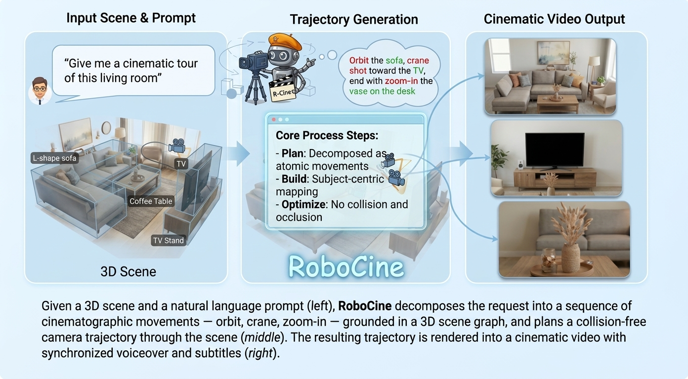

# RoboCine — 机器人电影拍摄

**RoboCine** 从 3D 地图、运镜推荐、主体 6D 位姿出发，规划**无碰撞、无遮挡、满足无人机能力约束**的电影级相机轨迹，并给出可执行设定点与仿真回放；随后根据具身选型，通过全身控制器拍摄出真实分镜。

<p align="center">
  
</p>
<p align="center">
  <sub><b>Teaser</b> — 运镜推荐 + 3DGS 点云 + 主体 6D 位姿三路输入，在重建场景上规划无碰撞电影级轨迹（相机轨迹按时间着色，蓝→红）</sub>
</p>

导览：60 秒看结果 → [快速开始](#60-秒-demo离线-mockplanner)；一条命令跑全公寓 → [一键全公寓场景](#一键全公寓场景)；真实点云三输入 → [Replica 三输入全链路](#replica-3dgs三输入全链路)；仿真回放 → [Gazebo Fortress](#gazebo-fortress-速览)。

## 总览

两大块 + 一条闭环：

```
[① VLM 运镜推荐]                          [② 运镜轨迹自主规划 cinema_traj]
 场景大类/小类 + 主体大类/小类 + 深度          3D 地图 + 运镜请求 (+主体轨迹)
 （训练数据管线 → 运镜推荐模型）               → 无碰撞参数化轨迹(SDF 优化)
        │                                     → 能力约束重定时(retime)
        │                                     → ROS2 / Gazebo Fortress
        │                                              ▲
        └──── 推荐输出 = 自然语言运镜请求 ───────────────┘
              （即 plan 阶段 --prompt 的输入，闭环接口已对齐）
```

| 模块 | 现状 |
| --- | --- |
| ① VLM 运镜推荐 · 训练数据管线 | **数据底座已落地**（`vlm_intention/`，见文末）：VLM 5-tag 校准 + 单目深度主标注 + 数据重分布 → 训练集；标注 schema 与运镜推荐模型为下一阶段（若已在别处实现，直接对接下方闭环接口） |
| ② 运镜轨迹自主规划 | **全链已落地**（`cinema_traj/`：extract → plan → build → optimize → export → retime → NED CSV / ROS2 bridge / Gazebo 回放） |
| 闭环接口 | 推荐器输出 = `run_traj.py --prompt "…"`（或 config 的 `cinema_traj.prompt`），plan 阶段无需改动 |

两个子项目：

1. **cinema_traj/** — CinemaTraj 式（arXiv 2607.26910）运镜轨迹规划器：3D 地图 + 自然语言运镜请求 +（可选）动态主体轨迹 → 无碰撞、无遮挡的参数化相机轨迹。含论文全部 13 种原子运镜 + **动态主体跟拍扩展**（track_follow / track_orbit / track_lead，论文明确列为 future work）。
2. **vlm_intention/** — 训练数据流水线（运镜推荐的数据底座）：五方向（前/左/右/上/下）障碍物标注 + 数据重分布。

```
3D 地图 (PCD/PLY/场景 JSON) ─▶ extract ─▶ 场景图 (房间 / 物体 OBB / 贴墙挂顶 / 门洞)
自然语言运镜请求 (motion prompt) ─▶ plan ─▶ LLM 分解为 1-3-1 原子运镜计划
动态主体轨迹 (subject pose, 可选) ─┐
                                   ▼
              build: anchor 五项打分 + 13 种参数化运镜 + 3 种跟拍原语实例化
                                   ▼
              optimize: 解析式可微 OBB-SDF 两阶段梯度优化（碰撞 + 遮挡 + 门洞路由）
                                   ▼
              export: 通用轨迹 JSON / CSV / 无人机设定点 + 离线 HTML 3D viewer
```

| 阶段 | 输入 | 输出 | 说明 |
| --- | --- | --- | --- |
| extract | PCD / PLY / NPZ 点云 | 场景图 JSON 草稿 | 无语义几何检测（地板/天花/墙 + 聚类），需人工修订标签 |
| plan | 场景 JSON + 运镜请求 | plan.json | LLM/Mock 1-3-1 分解 + 校验 |
| build | plan.json + 场景 | traj_init.json | anchor 打分 + 参数化轨迹实例化 |
| optimize | traj_init.json | traj_final.json | 两阶段 SDF 优化 + 逐帧指标（碰撞率/遮挡率/最小间隙） |
| export | traj_final.json | exports/ | 通用 JSON/CSV + 无人机设定点 + NED simulator CSV（超速时自动连带 retime） |
| retime | traj_final.json | exports/*_retimed + simulator_csv | 能力约束重定时（弯角减速/姿态 slew/时长拉伸），20Hz ZOH 体指令 |
| view | traj_final.json | viewer/*.html | 自包含离线 3D 查看器（时间轴播放、碰撞/遮挡标记） |

模块结构与 `config.yaml` 的 `cinema_traj:` 配置段细节见 `cinema_traj/` 各模块 docstring；各阶段数学原理见 [算法与数学](#各阶段算法与数学原理)。

## 快速开始

### 安装

```bash
git clone git@github.com:civicW/RoboCine.git && cd RoboCine

# Python 环境 —— Isaac Sim 5.1 官方 pip 发行（conda 空壳 + pip 装全部）
conda create -n env_isaaclab python=3.11 -y && conda activate env_isaaclab
pip install -r requirements.txt
pip install -e ".[traj]"                                # torch + 轨迹规划依赖
pip install "isaacsim[all,extscache]==5.1.0"            # 仅 simview/gsplat 渲染需要
#   https://docs.isaacsim.omniverse.nvidia.com/latest/installation/install_python.html

# 大资产不在 git（gitignore），一次性补齐（幂等：缺啥下啥；--list 只列状态）
pip install huggingface_hub
python scripts/download_assets.py
#   → datasets/interioragent 601MB（Kujiale 001 场景）+ 默认主体 Xbot.glb ~2.9MB

# Kit 首启必须答一次 EULA（答过则已持久化；自动化建议静默通过）
export OMNI_KIT_ACCEPT_EULA=yes
```

硬件门槛（NVIDIA 官方）：Ubuntu 22.04+、NVIDIA GPU + 驱动 ≥ 535（本机 RTX 5090 / 580），详见 [硬件 FAQ](https://docs.isaacsim.omniverse.nvidia.com/latest/installation/requirements.html)。**注意**：Replica mcmc 数据为非商业研究许可——公开仓库前须移除（见 .gitignore 注释）。

### SAM 2.1 独立环境

SAM 2.1 使用独立的 Conda 环境 `sam2`（Python 3.11、PyTorch 2.11.0、CUDA 12.8）；
现有规划、ROS 2 和 Isaac Sim 功能继续使用原环境。`sam2` 激活时隔离继承的
`PYTHONPATH` 和用户级 Python 包，退出时恢复原设置。Meta 上游源码位于 `sam21/`，Base+ 与 Large 权重位于
`sam21/checkpoints/`；该目录整体由 `.gitignore` 排除。

```bash
# 在项目根目录执行；sam21 目录不存在时拉取
git clone https://github.com/facebookresearch/sam2.git sam21
conda env create -f environment.sam2.yml
conda activate sam2

# 编译 RTX 5090（sm_120）的 CUDA 后处理扩展，并安装图片/视频推理依赖
bash scripts/install_sam2.sh

# 两种模型的 GPU 图片分割、三帧视频跟踪和 CUDA 扩展检查
python tools/sam2_smoke.py
```

权重为 `sam2.1_hiera_base_plus.pt` 和 `sam2.1_hiera_large.pt`，对应配置分别为
`configs/sam2.1/sam2.1_hiera_b+.yaml` 和 `configs/sam2.1/sam2.1_hiera_l.yaml`。
安装元数据中的包名/版本是 `SAM-2 1.0`，模型版本由这两份 **2.1** 权重和配置决定。
重新下载时可从 [Meta 官方权重目录](https://github.com/facebookresearch/sam2#download-checkpoints)
选择这两个文件；官方 `download_ckpts.sh` 会额外下载 Tiny 和 Small。

### 60 秒 Demo（离线 MockPlanner）

```bash
python run_traj.py --stage all \
    --scene cinema_traj/demo/demo_apartment.json \
    --prompt-file cinema_traj/demo/demo_prompt.txt --mock
# 产物: cinema_traj_out/demo_apartment/{plan,traj_init,traj_final}.json
#       + exports/{traj_samples.json,traj_samples.csv,drone_setpoints.csv,
#                 drone_setpoints_retimed.csv, simulator_csv/}
#       + viewer/demo_apartment.html  ← 浏览器直接打开（无外部依赖）
```

纯 Python/torch、无 ROS 依赖，规划+优化 demo 34s 跑完（CPU）。换真实 LLM（LM Studio 跑 Qwen3-VL）去掉 `--mock`，确认 `config.yaml` 的 `cinema_traj.planner.api_url` 指向 LM Studio；规划失败会自动带校验错误重试一轮（1-3-1 模式 + placement 约束 + 目标存在性检查）。

### Scenario demo：沙发三人（pipeline 生成相机 + Isaac 渲染）

```bash
scripts/run_scenario_kujiale_0021_sofa_trio.sh   # 预设: 沙发三人（静态 cast）
scripts/run_scenario_kujiale_0021_xbot.sh        # 预设: Xbot 行走主体三运镜
# 通用入口（新 scenario 用它；上面两个脚本就是它的一组环境变量预设）:
SCENARIO=<name> bash scripts/run_scenario.sh
```

`run_scenario.sh` 本身不含任何场景常量——`SCENARIO`/`DO_RENDER`/`CAMERAS`/
`WIDTH`/`HEIGHT` 都由环境变量传入；给新 scenario 写个 3 行的
`run_scenario_<name>.sh` 预设脚本即可（复制现有那个）。

这条脚本跑通「场景配置 → 相机轨迹 → Isaac Sim 渲染视频」全链路；**所有
相机坐标都由 cinema_traj 流水线计算，不存在手写相机数字**：

1. `tools/scenario_gen.py` 读场景配置 yml → 生成 `plan.json`（纯语义
   beats）→ `build` → `optimize` → 写 `cast.json` → 对优化结果做
   清场审计（硬断言 ≥0.10 m，含人体模型）
2. `tools/simview_isaac.py build` 组装 USDA 舞台（环境 + 静态演员 + 摄像机）
3. `tools/simview_isaac.py render` 无头渲染 ShotCam(POV)+OverviewCam → mp4

新 scenario 只需两个文件 + 一个预设脚本：

| 文件 | 内容 |
|---|---|
| `cinema_traj/scenes/<scenario>.json` | 场景；**摆进去的人必须以 `person_*` 障碍 OBB 写进 objects**（否则优化器只认识场景 SDF，会穿人） |
| `cinema_traj/scenes/config/<scenario>.yml` | staging（cast/props 摆位）+ intent（beats：anchor 高度/距离 + traj 类型/时长）+ audit（清场界限） |

迭代相机构图用 `DO_RENDER=0`（跳过 Isaac，秒级）。当前 yml 的 beats：
pan_right 8 s → arc → move_in 6 s → arc → move_out 6 s（绕 sofa 的 orbit
在该几何下不可行——Kid 坐在 orbit 圆心上，任何环半径都会穿人，所以用
wide 位横摇代替）。

### 一键全公寓场景（推荐 → 优化 → 重定时 → 3D 回放）

```bash
source .venv/bin/activate
scripts/run_full_scene_chain.sh 2 open      # result2 = 环绕跟随（track_orbit）
scripts/run_full_scene_chain.sh 1           # result1 = 前推（move_in）
scripts/run_full_scene_chain.sh 4 open      # result4 = 竖摇（tilt_up）
```

编号即 `datasets/CameraMovementsRecommand_output_json/` 里的运镜 mock（`results.json` 为上游正式输出名，`result0-11.json` 为手工 mock）：0 推镜 / 1 前推 / 2 环绕跟随 / 3 环视 / 4 竖摇 / 5 横移 / 7-9,11 环绕变体；10「百万运镜」是占位词，映射表故意不收——跑它会得到清晰的「未识别运镜类型」报错。

脚本 ⓪ 步只在 `datasets/replica_v1/.../mesh_semantic.ply` 存在时才重跑 `replica_autosem --full`，否则直接用仓库已提交的全公寓场景；随后依次 recommend → build → optimize → export → retime → view，`open` 参数跑完自动打开 viewer。

Viewer 操作：拖动旋转 · 滚轮缩放 · 空格播放 · B 切云密度（微/少/密/无）· P 点云 · L 标签 · C 纯景；右下小地图为房间邻接图——门连线、红色运镜轨迹（过渡弧为分段色细线）、假人虚线路径、相机实时位置，所在房间高亮。

已知行为：`--full` 全公寓场景的环绕类运镜可能被可行域钳制收紧甚至触发清晰报错（保护行为，非 bug，详见[回归测试与已知行为](#回归测试与已知行为)）。

## 场景输入

三种获取权威场景 JSON 的途径。extract 草稿给物体起的是 `object_NN` 通用名——人工改 label / placement / 房间划分 / 门洞后，才是权威场景输入。

### Replica 3DGS：三输入全链路

上游推荐 `results.json`（JS 回调字面量）+ 3DGS 点云 + 合成主体轨迹 → 无碰撞电影级轨迹，一次跑通（2026-08 验证于 `frl_apartment_0`）。

```bash
cd /path/to/RoboCine && source .venv/bin/activate        # 仓库根目录起跑
# ① extract：Replica 3DGS PLY → 场景草稿（SceneSplat 数据集 Z-up 地面在XY，
#    --up z 入口旋转成内部 Y-up；3DGS 密度高，墙峰阈值降到 3.0）
python run_traj.py --stage extract \
    --map datasets/replica_mcmc_3dgs/frl_apartment_0/ply/point_cloud_30000.ply \
    --scene-out cinema_traj/scenes/frl_apartment_0.json --wall-peak 3.0 --up z
#    ⚠️ 精修版场景 JSON 已提交入库：重跑 ① 会报 FileExistsError（保护行为）；
#       --force 会覆盖人工精修成果，仅在想从头重提草稿时使用
# ② 人工精修草稿（Y 上移使地板=0、语义 label、收敛到南端客厅）→ 已提交
#    cinema_traj/scenes/frl_apartment_0.json（楼梯/矮柜/扶手椅/茶几/电视墙…）
# ③ 注入假人：客厅南侧走道行走 0.6 m/s，中途停 10 s 供推镜
python scripts/add_subject_track.py --scene cinema_traj/scenes/frl_apartment_0.json \
    --waypoints "0.3,-2.6 0.5,-2.6 2.3,-2.5" --speed 0.6 --height 1.65 --pause "0,10,0"
# ④ recommend：容错解析推荐输出 → 前推运镜 → move_in 直指假人（无需 LLM）
python run_traj.py --stage recommend \
    --raw datasets/CameraMovementsRecommand_output_json/results.json \
    --scene cinema_traj/scenes/frl_apartment_0.json --force
# ⑤ build → optimize → export → retime → view（--force 允许覆盖上轮产物）
python run_traj.py --stage build    --scene cinema_traj/scenes/frl_apartment_0.json --force
python run_traj.py --stage optimize --scene cinema_traj/scenes/frl_apartment_0.json --force
python run_traj.py --stage export   --scene cinema_traj/scenes/frl_apartment_0.json
python run_traj.py --stage retime   --scene cinema_traj/scenes/frl_apartment_0.json --force
python run_traj.py --stage view     --scene cinema_traj/scenes/frl_apartment_0.json
```

`recommend` 阶段把上游输出容错解析为 1-3-1 计划并补齐缺省合同字段（中文运镜→原子类型映射表在 `cinema_traj/stages/recommend.py`，未识别的运镜名报错而不是错拍；解析细节见[算法与数学](#各阶段算法与数学原理)）。多视频批次用 `--video-index N` 选条目（如 `possible_results.json` 的 9 条）。

### InteriorAgent USD 场景（spatialverse/InteriorAgent，如 kujiale_0021）

InteriorAgent 给的是 USD 场景（usda + 每资产一个 `Meshes/*.usd`），不是点云。`scripts/usd_to_ply.py` 把舞台网格按面积均匀采样成点云 + 语义边车（每资产世界系 OBB + 资产名标签 + rooms.json 房间归属），`scripts/refine_scene_from_sidecar.py` 用边车一次性替代 extract 草稿的通用标签/重复墙 → 权威场景 JSON（2026-09 验证于 `kujiale_0021`：5 房间 / 45 物件 / 5 门，全链 mock 碰撞率 0%）。

⚠️ 命名分工：`cinema_traj/scenes/kujiale_0021.json` 已被 simview 管线占用（Isaac Sim 渲染用的自动稠密场景，按 scene_id 固定读取），本链路输出 `kujiale_0021_traj.json`（脚本默认即带 `_traj` 后缀）。

```bash
pip install usd-core   # 一次性；venv 里已装
# ① 下载（只需要 usda/rooms.json/Meshes；.thumbs/Materials/HDR 可跳过）
hf download spatialverse/InteriorAgent --repo-type dataset \
    --include "kujiale_0021/kujiale_0021.usda" "kujiale_0021/rooms.json" \
              "kujiale_0021/Meshes/*" --local-dir datasets/interioragent
# ② USD → 点云 + 边车（资产图层是 cm 尺度，实例变换带缩放 —— 采样在世界系做）
.venv/bin/python scripts/usd_to_ply.py \
    --usd datasets/interioragent/kujiale_0021/kujiale_0021.usda \
    --rooms datasets/interioragent/kujiale_0021/rooms.json
# ③ extract（InteriorAgent 为 Z-up，--up z；PLY 保持原生坐标，viewer 靠 map_up=z 对齐）
python run_traj.py --stage extract \
    --map datasets/interioragent/kujiale_0021/kujiale_0021.ply \
    --scene-out cinema_traj/scenes/kujiale_0021_draft.json --up z
# ④ 边车精修：语义物件(≥0.35m，top 45) + 真实墙/顶/地 + door 归门(不挡过道)
.venv/bin/python scripts/refine_scene_from_sidecar.py \
    --scene cinema_traj/scenes/kujiale_0021_draft.json \
    --sidecar datasets/interioragent/kujiale_0021/kujiale_0021_sidecar.json
# ⑤（可选）注入假人 + 全链（同 Replica 流程；--mock 离线或接 LM Studio 真规划）
python scripts/add_subject_track.py --scene cinema_traj/scenes/kujiale_0021_traj.json \
    --waypoints "3.2,1.0 6.0,0.6 9.0,0.6" --speed 0.6 --height 1.65 --pause "0,10,0"
python run_traj.py --stage all --scene cinema_traj/scenes/kujiale_0021_traj.json \
    --prompt "近景前推 sofa，随后跟拍行走的假人" --mock
```

已踩过的坑（脚本已内置处理）：资产几何是厘米、`metersPerUnit` 却写 1.0——必须信任组合后的世界变换；Gf 矩阵平移在**最后一行**（row-vector 约定）。

### 自己的 PCD：从零到跟拍（五步，无真实地图也能跑）

```bash
# ① 合成演示房间 PCD（6×6×2.7m + 2 家具盒 + 1 目标盒，零依赖）
python scripts/make_demo_room_pcd.py
# ② extract：PCD → 场景图草稿（自己的地图直接换 --map your_map.pcd --review）
python run_traj.py --stage extract --map cinema_traj/demo/demo_room.pcd --force
# ③ 注入假人（走路路点模式；静态主体用 --static x,z --heading 30）
python scripts/add_subject_track.py --scene cinema_traj/scenes/demo_room.json \
    --waypoints "-2,-2 1,-2 1,1" --speed 1.0 --pause 0,3,0
#    （把草稿里的 object_NN 改成语义 label —— sed 或手编）
# ④ plan → build → optimize → export → retime → view（MockPlanner 离线）
python run_traj.py --stage all --scene cinema_traj/scenes/demo_room.json \
    --prompt "环绕目标盒一圈后跟拍假人" --mock --force
# ⑤ 单独重跑 retime（也可换 --stage view 看 3D 回放）
python run_traj.py --stage retime --scene cinema_traj/scenes/demo_room.json
```

验证 retime 效果：`exports/traj_samples_retimed.json` 里每段速度/加速度/角速率均满足 `config.yaml` 的 `cinema_traj.retime` 能力约束（默认 DJI Mini 3 演示档：水平 1.0 / 升降 0.5 m/s、水平 0.5 / 垂直 0.3 m/s²、yaw/云台 20°/s，**保守值非厂商极限**——约束紧则时长拉伸明显，可按机型放宽）。

## 部署与仿真回放

```
[本地 macOS/Linux — 纯 Python/torch，无 ROS 依赖]        [Linux ROS 2]
PCD → extract → 场景 JSON ─ add_subject_track(假人) ┐
                                                   ▼
   plan(LLM/mock) → build → optimize(SDF) → export(traj_samples)
                                                   │
                                          retime(执行层能力约束)
                                                   │
                    ┌──────────────────────────────┼───────────────┐
                    ▼                              ▼               ▼
          drone_setpoints(_retimed).csv   simulator_csv/v1 NED   ros2 bridge:
          (Y-up 通用设定点)               (Kotlin 工具链可回放)    nav_msgs/Path →
                                                                     /cam_desired_traj
                                                                     (latched) + RViz
                                                                     MarkerArray
```

- **规划/优化在本地跑**，不需要 ROS（见上文 60 秒 Demo）。
- **ROS2 桥在 Linux 跑**：`ros2_ws/cinema_traj_bridge`（ament_python 包），构建/运行/验证见 [`ros2_ws/README.md`](ros2_ws/README.md)；核心映射逻辑在 `traj_loader.py`（纯 Python，macOS 可单测：`python -m pytest tests/test_traj_loader.py -q`）。
- **Gazebo Fortress (gz-sim6, Humble) 演示**：`ros2_ws/cinema_traj_gz_demo` 在合成房间里回放重定时轨迹；安装/构建/验证步骤见 [`ros2_ws/README.md`](ros2_ws/README.md)。
- **交换格式**：`exports/simulator_csv/`（`camera-motion-offline-trajectory/v1`，NED/FRD，与第三方 trajectory-simulator 的 CSV/summary 逐列兼容）。
- `scripts/action_to_ros2.sh` 一键串起 recommend→retime 并起 ROS2 bridge——bridge 部分需要 Linux/ROS2，Mac 上请用 `run_full_scene_chain.sh` 或分步命令。

### Gazebo Fortress 速览

环境为 Ubuntu 22.04 + Humble + gz-sim6，细节见 ros2_ws/README.md。

```bash
sudo apt install ros-humble-desktop ros-humble-ros-gz \
                 python3-colcon-common-extensions      # ① 环境（一次性，gz-fortress 随 ros-gz 装上）
git clone https://github.com/civicW/RoboCine.git && cd RoboCine/ros2_ws
colcon build --packages-select cinema_traj_bridge cinema_traj_gz_demo  # ② 构建
source install/setup.bash
ros2 launch cinema_traj_gz_demo demo_room.launch.py    # ③ gz-sim6 里看回放
```

应看到：合成房间（6×6×2.7m、三盒子、开顶）里橙色四旋翼绕黄色目标盒一圈（拐角减速 = Mini3 能力约束的体现）后走跟拍段；默认 `time_scale=10`（重定时 demo 全长 244.8s，约 25s 看完）。launch 同时起 `ros_gz_bridge`（`/world/demo_room/set_pose` → `SetEntityPose`）与 `traj_server`，可用 `ros2 topic echo /cam_desired_traj --once` 验证 latched 路径、`rviz2` 叠加 Path/MarkerArray。

注意：`path_player` 经 `set_pose` 做**运动学回放**（与可执行轨迹的纯运动学语义一致）；物理级/离板控制测试走 PX4 SITL 路线（见 ros2_ws/README.md 末节）。

## 查看与渲染

### Isaac Sim 5.1 查看器（simview）

`tools/simview_isaac.py` 把同一份输入（scene JSON + traj_final.json）转成 USD 并用 Isaac Sim RTX 渲染：POV 实拍预览（真实 FOV 相机）、动态主体、3DGS 点云真彩、碰撞/遮挡标记球、环境网格化（baked vertices，避免缩放 Cube 的 RTX 法线问题）+ 室内灯光网 + 随动头灯 CamLight。

```bash
# conda env：env_isaaclab（Isaac Sim 5.1 全 pip 安装在其中；
# 原生 GUI 启动 `conda activate env_isaaclab && isaacsim`；EULA 用环境变量跳过）
source ~/miniconda3/etc/profile.d/conda.sh && conda activate env_isaaclab
export OMNI_KIT_ACCEPT_EULA=yes

# 三大子命令（gui 在 NoMachine 桌面里开 Terminal 跑；render 无头渲染，后台可用）
python tools/simview_isaac.py build  --traj cinema_traj_out/<scene>/traj_final.json
python tools/simview_isaac.py gui    cinema_traj_out/<scene>/simview/simview.usda
python tools/simview_isaac.py render cinema_traj_out/<scene>/simview/simview.usda --every 1.0 --mp4
# 产物: <scene>/simview/{simview.usda,meta.json} + frames/{ShotCam,OverviewCam}_*.png
```

常用选项：

- `--subject-glb <path.glb>` 用 GLB 人形（取绑定姿态几何、纹理忽略 → 静止雕像沿 subject_track 行走）替代橙色胶囊（含头部/朝向鼻点）；`datasets/simview_assets/Xbot.glb` 存在时会自动使用，但仓库不附带该资产。
- `--cast <cast.json>` 把人物在指定动画帧烘焙成静态摆放；支持 Isaac People 静态 USDA 和 KayKit/Kenney 类蒙皮 GLB，并可按 `seat`、`contact` 或 `floor` 锚点对齐。
- 恒定 FOV 的轨迹只写静态 `focalLength`，变焦镜头才写时间采样；`--overview-offset="x,y,z"` 可调整总览相机方位。
- `--env-style solid|wireframe|off|boxes`：场景带 `provenance.env_usd`（如 kujiale_0021，真渲染公寓）时默认渲染家具网格，调试碰撞盒请显式用 `boxes`（wireframe/off 下点云全景无遮挡）。
- `--cloud-voxel 0 --cloud-max-points 0` = 全量点云（1.5M pts，~90MB usda）。
- gui 模式：viewport 相机选 `/World/ShotCam` 即是 POV，时间轴直接拖动。

克隆后大资产不在 git（gitignore 规则）：`datasets/interioragent/`（601MB，
Kujiale 001 场景，simview 环境）等非跟踪件。一次性补齐：

```bash
pip install huggingface_hub            # 数据集客户端
python scripts/download_assets.py      # 幂等：缺啥下啥；--list 只列状态
```
（`datasets/CameraMovementsRecommand_output_json` 与 Replica frl 点云在仓库内，
Replica mcmc 数据为非商业研究许可——公开仓库前须移除，见 .gitignore 注释。）

无头渲染说明：headless Hydra 不认 Camera/gprim 的时间采样，`render` 用逐帧扁平静态 stage；GUI 保留时间采样 master。

### 真 3DGS 渲染（gsplat 适配器 — `tools/gsplat_render.py`）

Isaac Sim 5.1 pip **不原生支持 Gaussian Splatting**（CUDA 体积渲染核缺失）；用 Nerfstudio `gsplat`（社区标准 CUDA 渲染器，`nv-tlabs/3dgrut` 同类备选）在 Isaac 之外渲染真 3DGS POV——同一份轨迹数据、同一套相机数学，不需要 Isaac Sim 启动。

```bash
# 一次性安装（env_isaaclab；nvcc/headers 装在 conda env 内，不动系统）
conda install -y -c nvidia -c conda-forge cuda-toolkit=12.8.* && \
conda install -y -c nvidia cuda-cudart-dev=12.8.*
export CUDA_HOME=$CONDA_PREFIX CPATH=$CONDA_PREFIX/targets/x86_64-linux/include:${CPATH:-}
export MAX_JOBS=10 TORCH_CUDA_ARCH_LIST="12.0"     # RTX 5090 = sm_120
pip install gsplat==1.5.3                          # 锁定版本；首次渲染 JIT 编译 ~1min

# 渲染 POV（轨迹 × 场景 3DGS 点云；帧率/分辨率自调）
python tools/gsplat_render.py --traj cinema_traj_out/frl_apartment_0_autosem_full/traj_final.json \
    --width 960 --height 540            # scenes/<id>.json 的 provenance 提供 PLY 与 y-up 转换
# 产物: cinema_traj_out/<scene>/simview/frames_splat/{ShotCam_*.png, ShotCam_splat.mp4}
```

实现口径：PLY(xyz, f_dc, opacity, scale, rot) → gsplat tensors（log-scale exp / sigmoid opacity / quat 归一化 / `rgb = 0.5 + 0.2820548·f_dc`）；相机采用物理 look-at（+X 成像右, +Y 成像上, -Z 视向）→ gsplat OpenCV（x右, y下, z前）视图矩阵；--up z 修正 + provenance.map_shift。与 Isaac RTX 输出逐帧位置一致（`tests/test_gsplat_adapter.py` 钉住朝向语义）。

## Jarvis 平台：可达性 + 可跟踪性（floor-robot 运镜）

`cinema_traj.platform: jarvis` 把规划器从"无人机相机轨迹"切换成"Jarvis（差速底盘 + 6 自由度臂）可执行的运镜轨迹"，CLI 表面不变。机器人定义 vendor 自 `ros2_ws/jvs_mock`（分支 `yuelin/isaac-robot-controller`：`jvs_mock.urdf.xacro` 的非对称关节盒 joint2 [-1.187, 0.698]、joint5 [-2.618, 0.035] 与逐关节速度上限，`jarvis_controllers.yaml` 的底盘线/角速度与加速度）。

两层约束，两层机制：

* **可达性（reachability，几何层）** — 重定时只能拉伸时间轴、不能改形状，所以必须在几何层压回工作空间：FK 采样 + IK 实测出相机可达带（物理 ≈ [0.13, 0.96]m，且高度与俯仰耦合：水平视线需 z ≥ ~0.55m、陡俯视需 z ≤ ~0.85m、上仰 +45° 需 z ≥ ~0.7m），`build` 阶段逐段钳制（orbit 高度/底盘伴飞圆、crane 竖直弧、track 仰角×距离、dolly 拍摄高度、静态机位 anchor），anchor 候选先过滤出带；`optimize` 后密采样逐点 `camera_reachable()`（底盘落点 SDF 净空 + 臂 IK）做硬审计，报告写进 `traj_final["jarvis_reachability"]`。
* **可跟踪性（trackability，执行层）** — 与消费端全身 QP 控制器（`jvs_mock/whole_body_controller`，8 维硬边界速度级 QP：u = [v_base, ω_base, q̇1..6]）对齐：retime 共享循环按平台能力多态化，Jarvis 侧方向可跟踪域 `v_max(û) = min_i cap_i / |(J⁺[û;0])_i|`（前向 ≈0.84 m/s 由底盘驱动、垂直 ≈0.14 m/s 只能靠臂——差速底盘的横向/垂直不对称自动从雅可比里长出来），`check_trackable` 对导出构型流做有限差分精确验证（含轮级约束 |v|+|ω|·b/2 ≤ 1.05 m/s——QP 对轮对强制的同一约束）。

导出：`exports/jarvis_traj.json`（t, base[x,z,yaw], q1..6, 相机位姿——`fix_dwell_arcs` 修复、出生点提取与可跟踪性证明的载体）+ `jarvis_setpoints.csv`（v_base/ω_base/q̇ 逐区间前馈）；相机流 `traj_samples_retimed.json` 每帧带 `robot_quat_wxyz`——机器人**光学系**（Z+ 前 / X+ 右 / Y+ 下，body→world）姿态，旧导出缺该字段会明确报错、重跑 export 即可。`scripts/export_jarvis_trajectory.py` 把它转成 WBC 消费的 `jvs_relative_task_space_trajectory/v1`（见下节）；traj_server → `/cam_desired_traj` 仅剩 Gazebo demo 与 RViz 可视化在用（`planner="jarvis"` 模式直接采用光学系四元数），全身 QP 的硬边界在线分配不会削规划形状（底盘 QP 限比规划 cap 更紧、关节限与 URDF 一字不差）。

转 arm 执行格式：`scripts/export_jarvis_trajectory.py` 把导出轨迹转成 `jvs_relative_task_space_trajectory/v1`（10 Hz 重采样，每帧位姿相对样本 0、表达在起始光学系）：

```bash
python scripts/export_jarvis_trajectory.py \
    --traj cinema_traj_out/<scene>/exports/traj_samples.json \
    --out  cinema_traj_out/<scene>/exports/jarvis_task_space.json
# → ros2 launch jvs_mock jvs_follow_traj.launch.py trajectory_file:=…
```

配置：`cinema_traj.jarvis` 块可覆盖全部能力上限（默认 = min(URDF 硬件限位, WBC QP 关节限)——关节限与 `whole_body_qp.Limits` 逐字一致，底盘 cap 0.8/2.5 比 QP 的 0.5/1.2 松、QP 饱和在自己一侧兜底，轮级 |v|+|ω|·b/2 ≤ 1.05 m/s 两侧同式）；`jarvis.allow_unreachable: true` 让导出在个别不可达采样点保持上一构型（相机流不变，摘要计数）而不是报错退出——默认严格。

实测行为（demo 公寓 / kujiale_0021）：拍摄段（推近/跟拍等）由 build 阶段的可达性硬门保证——anchor 候选逐个"钳制 + 密采样可达性预审计"，全部候选失败则报错退出（不静默改运镜语义）；贴墙物体的环绕/推拉若底盘无伴行净空会被直接拒绝（物理约束）。重定时按段独立执行 + 逐区间驻足插入：不可达的 arc 采样点驻足（机器人停住、构型保持），跳变区间局部放宽时间轴，拍摄段速度不受拖累（kujiale：碰撞 0%、拍摄段可达 100%、总时长 41s，改前全局 ×162 拉伸 2764s）。紧角落过渡弧可能残留少量驻足点（审计逐点列出，摘要计 `held_configs`），过渡走廊的可达性预留是后续项。

## trajectory-simulator 的角色（第三方 Kotlin 包，未入库）

`trajectory-simulator-0.1.0-SNAPSHOT/`（本地保留、已 gitignore）是 DJI Mini 3 离线运镜规划包：14 种 MotionType、NED/FRD、20Hz ZOH 体速率指令、TrapezoidalVelocityProfile + ControlLimits + 精确闭式积分（1e-12 黄金测试）。它是纯运动学执行层——无避障/场景/优化/LLM（这些恰是 cinema_traj 已有的）；反过来 cinema_traj 此前只"警告"超速而不解决，它的执行层数学正是缺口。我们做了三件事（**未改任何 Kotlin 代码**）：

1. **移植 motion-math 到 Python 重定时层**（`cinema_traj/core/retime.py`，测试逐条对齐 Kotlin 1e-12 用例）——导出轨迹可证明满足速度/加速度/角速率约束：位置用前后向速度剖面（弯角减速、直线全速），yaw/云台用线性 ramp-rate（slew-rate limiter），必要时整体拉伸时长而不是裁剪路径形状。
2. **NED CSV v1 交换格式导出**（`exports/simulator_csv/`）——现有 Kotlin 工具链可直接回放。
3. **精确积分器做回归验证**（`tests/test_retime.py` 的 ZOH 复现测试）——验证指令流真的落在几何路径上。

## 论文对照（忠实 / 偏离 / 扩展）

| 部分 | 状态 |
| --- | --- |
| 三层工具集（anchor 选择器 + 13 种物体运镜 + arc 过渡）、1-3-1 模式、placement 硬约束 | ✅ 忠实 |
| anchor 候选生成（面法线偏置 ×4 距离 ×10 方位角 ×3 仰角）+ 五项打分（vis/dist/elev/open/perp，论文权重） | ✅ 忠实 |
| 参数化轨迹（θ_fix / θ_free）+ ease-in-out + look_at | ✅ 忠实 |
| 代价（C_sdf λ5/d_safe 0.2、C_occl 透射率 λ3/K32/β20、smooth 0.5、reg 0.1、bnd 5.0）、Adam lr1.0/1000 iter/plateau30/λ 自适应倍增 | ✅ 忠实 |
| 两阶段优化 + 跨房间门洞 BFS 路由（passage 打分 + 高度钳制） | ✅ 忠实 |
| SDF | ⚠️ 偏离：解析可微 OBB-SDF（论文为 OBB 网格 → 体素化 → marching cubes → 256³ 网格）；精确度等价（论文 SDF 同样由 OBB 构建）且零 mesh 依赖，接口可换回网格版 |
| 可见性 ray cast | ⚠️ 偏离：精确 ray-OBB slab 测试（语义相同，更便宜） |
| LLM | ⚠️ 偏离：LM Studio Qwen3-VL（论文 GPT-4.1），加校验反馈重试 |
| **动态主体跟拍**（主体胶囊时变障碍物 + 头部遮挡目标 + track_follow/orbit/lead + 主体安全间距代价） | 🆕 扩展（论文 §5/§K.2 列为局限） |

## 各阶段算法与数学原理

世界系约定：右手系、+Y up、米、yaw=0 → +Z。

### recommend — 容错解析 + 规则映射（无数值算法）

- 上游输出是 JS 回调字面量而非合法 JSON：全角标点归一化后，用正则定位已知 key 的出现位置、**按位置切片**取值（不 eval；`stages/recommend.py` 的 `parse_raw_recommendation`，上游改发合法 JSON 时走快速路径）
- 中文运镜 → 原子类型：长关键词优先的有序字典匹配；缺失合同字段按语义查表补齐（节奏"中"→0.6 m/s、"水平"→云台 0°），并在 `defaults_filled` 记录
- 时长推算：推/拉按行程 `duration = 1.2 m / movement_speed`（× 节奏系数），其余按默认时长；产出 1-3-1 结构计划（N 目标恰好 3N−1 步），由 `core/plan_schema.py` 校验（完整版 plan 阶段是 LLM 分解 + 校验失败反馈重试，recommend-adapter 是纯规则适配器）

### build — anchor 采样打分 + 参数化原子轨迹

anchor 选择（`core/anchors.py`，论文 §3.3.1）：

- 候选生成：每个可达 OBB 面 × 4 距离系数 × 10 方位角（面法线 ±45°）× 3 仰角，方向 `n̂·cos(el) + (û·cos(az) + v̂·sin(az))·sin(el)`；解析 SDF 预过滤碰撞
- 观看距离：`median(OBB extents) × 1.2`，clamp [0.3, 3.0] m 且 ≤ 房间最小水平边长的 40%
- 五项加权打分：vis（目标 8 角点的 ray-OBB slab test 可见比例）+ dist（高斯核 `exp(−(d−d*)²/2σ²)`，σ=0.35·d*）+ elev（帐篷函数）+ open（到房间中心线性衰减）+ perp（视线与墙内法线的余弦相似度，贴墙物体专用）

参数化轨迹（`core/trajectories.py`）：每段是 `τ(t; θ_fix, θ_free)`，固定参数来自锚点/几何，自由参数带 (value, lo, hi) 边界留给优化器，全部 torch 求值：

- dolly（move_in/out）：`p = c + d̂·lerp(r_s, r_e, t̂)`；orbit：圆柱坐标 `p = (c.x + r·cosφ, h, c.z + r·sinφ)`；crane：固定方位角/半径的仰角扫描
- arc 过渡（论文 eq. 4）：`p = (1−t̂)p_s + t̂p_e + (L/2)·tan(α)·sin(πt̂)·n̂`（弦插值 + 正弦凸起，n̂ = 弦 × 世界向上的叉积）
- pan/tilt：定点、look_at 目标绕轴旋转；zoom：焦距包络 `f = f₀[1+(m−1)sin(πt̂)]` 转 FOV `fov = 2·atan(tan(fov₀/2)/m)`
- track_*（扩展）：主体朝向系球偏移，再绕 Y 旋转 `rot_y(−heading)`
- 缓动统一 smoothstep `σ(t) = 3t² − 2t³`（端点速度为 0）

### optimize — 解析式可微 SDF 两阶段梯度优化

场景 SDF（`common/sdf.py`）：解析 OBB SDF 的并 `Φ(p) = min_i sdf_obb_i(p)`（单个盒 SDF 为精确式 `‖max(q,0)‖ + min(max(q),0)`；论文用体素化网格，见上表偏离说明；可选 log-sum-exp soft-min 平滑盒间接缝）。

Pass 1 逐段优化（`core/optimizer.py`）：Adam（lr=1.0）+ ReduceLROnPlateau(30) + 梯度范数裁剪，**只优化该镜头类型的自由参数子集**（镜头风格保持）。代价（`core/costs.py`，论文 eq. 5–7）：

| 项 | 数学形式 |
| --- | --- |
| 碰撞（eq. 6） | 单边二次罚函数 `λ·mean(ρ(g) + ρ(g)²)`，`g = d_safe − Φ(p)`，ρ = ReLU（罚函数法，d_safe=0.2 m） |
| 遮挡（eq. 7） | 相机→目标 ray march 32 步，`h_m = softplus_β(δ_occ − Φ(r(s_m)))`，透射率 `T_m = exp(−Σ_{j<m} h_j)` — 体渲染/Beer–Lambert 式衰减，首个遮挡物主导 |
| 平滑 | jerk（加加速度）最小化：三阶有限差分平方和 |
| 正则 | θ 相对初值的 range 归一化偏差 |
| 边界 | 房间边界的指数势垒 `exp((margin − inside)/scale)` |

调度：碰撞=0 且遮挡=0 时早停；lr 衰减到 10% 后碰撞仍 >5% → λ_sdf 自适应倍增（×2 至 10³，罚函数 continuation）。

Pass 2：端点更新后重建 arc、只优化曲率角 α（碰撞 only）；跨房间弧分裂 = 房间连通图 BFS 最短路 + 门评分 `‖x−c_p‖ + ‖c_p−x_dest‖ + 0.5·pref(door)`，路径点高度钳进门洞竖直范围。

### export — 姿态提取 + 坐标变换（纯几何）

- look_at 旋转矩阵（Gram–Schmidt 正交化）：`f = normalize(target−eye)`、`r = up×f`、`u = f×r`；姿态提取 `yaw = atan2(f.x, f.z)`、`pitch = asin(f.y)`，roll 恒 0
- NED 变换（`core/retime.py`）：north=+X、east=+Z、down=−Y，`yaw_ned = 90° − yaw_world`；速度/角速度列由有限差分推导

### retime — 弧长重参数化 + 时间最优速度剖面（执行层）

几何路径形状**一点不动，只重写时间律** t = t(s)（`core/retime.py`，自 Kotlin trajectory-simulator 逐式移植，测试对齐 1e-12）：

1. 弧长重参数化：去共线点 → 累计弧长，位置/姿态按弧长线性插值
2. 顶点速度限制：拐角 `v = a·Δt/Δdirection`（使 20 Hz 设定流自身的离散加速度可行）+ 水平/垂直速度、爬升/下降分量限幅
3. 前向–后向传播（时间最优剖面）：`v[i+1] = min(v[i+1], √(v[i]² + 2a·ds))` 两遍扫描，端点静止；段加速度 `(v₁²−v₀²)/(2·ds) ≤ a` 由构造成立
4. yaw / 云台俯仰：slew-rate limiter（斜率限幅）跟踪期望角 + 末端静止尾巴补偿视角切换滞后
5. 闭环验证：逐区间复查全部能力约束（速度/加速度/角速率/ZOH 指令步长），有违反则整体拉伸时长（只拉伸、永不裁剪路径），不收敛即 raise
6. 输出 20 Hz ZOH 机体系 FRD 指令；yaw 旋转下的机体位移用 sin/cos **闭式精确积分**（无欧拉离散误差）

### view — 针孔投影 + 画家算法（自包含 HTML）

点云 0.15 m 体素降采样 + Int16 量化 + base64 嵌入（~30k 点 ≈ 180 KB）；零依赖 canvas 3D：轨道相机（yaw/pitch/dist 球坐标）→ 视图正交基 (r,u,f) → 针孔透视投影 `x′ = W/2 + f·x/z, y′ = H/2 − f·y/z`，隐藏面按面片深度排序（painter's algorithm），视锥按每帧真实 FOV 画 16:9 像平面矩形。

### reach — 一期全身可达性检查（具身检查器）

优化器把相机当点规划；reach 阶段回答"轮式底盘 + 桅柱 + 6 轴臂 + 平板相机
能不能把相机摆到每个采样位姿"。逐帧检查：①相机高度 ∈ 可达带
[桅柱顶−臂展, 桅柱顶+臂展]∩[底盘以上]；②底盘放置存在性——在相机地面投影
周围按几何可行的环带采样 16 角 × 5 半径候选底盘中心，要求
|相机−臂基座| ∈ [min_reach, max_reach] 且底盘+桅柱在三个探测高度上净空
≥ 底盘半径。失败输出与碰撞终验同款报告（段落/时间/位置/原因：高度带/
超臂展/底盘放置+最近障碍）。机器人尺寸在 `config.yaml` 的
`cinema_traj.robot`（`config.example.yaml` 有注释模板，**请按实测覆写**）；
look 方向一期假设球腕可达。`python run_traj.py --stage reach --scene …`。

**分层路线图**（运镜效果 ≈ 参考 mp4 ↔ results.json 推荐）：CinemaTraj 参数段
保持镜头风格 → 一期 reach 检查物理可行性（本阶段）→ 二期 KC-SVSDF 式全身
优化：变量 = 底盘 SE(2) + 6 关节，目标 ‖FK(q(t)) − x_ref(t)‖² + 碰撞罚 +
平滑罚，链式 Jacobian 把相机误差/逃逸方向反传到 9 DoF（arXiv 2608.07005
后端的运动学耦合梯度思想），跟踪容差 ε 超限即触发失败报告——reach 届时
退化为该优化器的前端可行性 oracle。

## 回归测试与已知行为

```bash
source .venv/bin/activate

# ① 单元回归（zsh 下勿把行尾 # 注释一起粘贴执行）
python -m pytest tests/ -q      # 76 项：cinema_traj（几何/轨迹/规划/优化/端到端）
                                #        + vlm_intention（schema/env/geometry/paths/balance/atomic_io）

# ② 分步验收（不用一键脚本时的等价命令；半公寓 autosem 场景）
python run_traj.py --stage recommend --raw datasets/CameraMovementsRecommand_output_json/result2.json \
    --scene cinema_traj/scenes/frl_apartment_0_autosem.json --force
python run_traj.py --stage build    --scene cinema_traj/scenes/frl_apartment_0_autosem.json --force
python run_traj.py --stage optimize --scene cinema_traj/scenes/frl_apartment_0_autosem.json --force
python run_traj.py --stage export   --scene cinema_traj/scenes/frl_apartment_0_autosem.json
python run_traj.py --stage retime   --scene cinema_traj/scenes/frl_apartment_0_autosem.json --force
python run_traj.py --stage view     --scene cinema_traj/scenes/frl_apartment_0_autosem.json

# ③ 保护行为演示：--full 全公寓场景 + 环绕运镜。错位隔断会挤压环绕可行域，
#    具体失败点取决于运镜：build 阶段可行域为空 → 清晰 ValueError（如 result1 前推
#    不受影响、result2 跟随会被钳制收紧）；retime 阶段 → 能力上限断言（如 result8
#    半圈环绕的 yaw 变化率超过无人机档位）。两种失败都拒绝静默输出坏轨迹：
scripts/run_full_scene_chain.sh 8 2>&1 | grep -E "ValueError|AssertionError" || true
```

已知行为（不是 bug）：`--full` 全公寓场景里 autosem 的 wall 隔断多处错位（如 wall_128 悬在客厅半空），环绕类运镜（orbit/环绕跟随）在假人现有停顿位可能被可行域钳制收紧、甚至触发上述 ValueError——修复需要 autosem 对 wall 实例做曼哈顿平面对齐（记录在案的后续工作）。跟随/推镜/摇镜类不受影响。

---

# VLMIntention — 障碍方向训练数据流水线

从原始视频到五方向（前/左/右/上/下）障碍物训练集的端到端流水线：
**raw → 筛选 → 自动标注（VLM 5-tag + 单目深度）→ 数据重分布采样 → 训练集**。

障碍物判定本质是几何问题（能不能撞上），所以**主标注用单目深度模型**（Depth-Anything-V2 metric）做确定性阈值判定；早期不稳定的 VLM 5-tag 标注保留为**校准集**。两者 schema 完全一致（扁平 5 方向布尔）。

```
raw mp4 (639) ──▶ filter ──▶ annotate_vlm  (校准参考)
                  (场景/         │
                   室内外)        ▼
                            annotate_depth (主标注)
                                  │
                            [calibrate]  (可选 QA: 阈值网格搜索)
                                  │
                                mine ───▶ 更多帧 + 深度标签 (数据重分布)
                                  │
                               balance ──▶ obstacle_annotations_train.json
                                            (每方向 ≥35% 正样本)
```

## 快速开始

```bash
pip install -e .                               # 或 pip install -r requirements.txt
# 系统依赖：ffmpeg / ffprobe（mine 阶段抽帧需要，须在 PATH）

# 单阶段
python run_pipeline.py --stage filter
python run_pipeline.py --stage annotate_depth --cpu            # MPS 死锁时用 --cpu
python run_pipeline.py --stage mine --mode full --frames 5
python run_pipeline.py --stage balance                         # → obstacle_annotations_train.json

# 全流程（filter → annotate_vlm → annotate_depth → mine → balance）
python run_pipeline.py --stage all

# 各阶段也可带完整 --help 直接跑
python -m vlm_intention.stages.annotate_depth --help
```

## 配置（config.yaml）

所有路径 / 阈值 / 模型 id / 采样参数都在 `config.yaml`，**默认值 = 当前行为**，不改动即复现今日结果。支持 `${paths.base}` 插值；用户 `--config my.yaml` 深合并覆盖默认。关键项：

- `paths.base` — 语料根，所有标注 key 相对它。
- `thresholds.dist_thresh` — 每方向碰撞距离（前 1.0m，左/右/上/下 0.5m）。
- `models.depth.outdoor_alias: indoor` — 室外也用 Indoor 检查点（Outdoor 在 AI 生成图上估距偏远）；改 `outdoor` 则按真实环境路由。
- `balance.include_external_sources: false` — 只收 `paths.base` 下真实存在的帧（Open-Images 在另一 base，默认被排除；要纳入须先把图拷到 base 下）。
- `thresholds.config_version` — 改阈值/模型后调版本号会让旧深度标注判为 stale（需 `--force` 重算）。

## 5-bool schema

所有产物统一格式（trainer 可直接合并/换文件）：

```json
{"前": true, "左": false, "右": true, "上": false, "下": true,
 "image_name": "x.png", "relative_path": "横屏/01城市/标注tag/x.png",
 "timestamp": "2026-08-12 ...", "model": "depth-anything/...Indoor-Large-hf"}
```

`DIRS = ["前","左","右","上","下"]`；人工纠正后顶层 5 布尔 = GT，模型原值快照到 `predicted` / `vlm_predicted` / `depth_predicted`（按工具不同）。

## 阶段说明

| 阶段 | 输入 | 输出 | 说明 |
|---|---|---|---|
| filter | `标注tag/video_labels.json` | `filter_manifest.json` | 场景/室内外分类清单，供 mine 室内池（pool B）；depth 自带 scene_env 路由 |
| annotate_vlm | keyframe 图 | `obstacle_annotations_final.json` | Qwen3-VL 5-tag（校准参考，需 LM Studio 运行）|
| annotate_depth | keyframe 图 | `obstacle_annotations_depth.json` + `.meta.json` | **主标注**：深度阈值判定，支持 `--force/--cpu/--per-category` |
| calibrate | depth + vlm | 一致性报告 + `depth_calibration_disagreements.json` | 可选 QA：阈值网格搜索 |
| mine | mp4 视频 | `obstacle_annotations_mined.json` | ffmpeg 抽帧 + 深度标注（数据重分布，缓解正样本稀疏）|
| balance | depth + mined (+OI) | `obstacle_annotations_train.json` | 贪心选 N 帧，每方向 ≥35% 正样本 |

### 数据分布与 balance

原始「每视频抽 1 帧、横跨大量空旷远景」造成每方向正样本 <5%，模型坍塌（Macro F1 0.19）。`mine` 从障碍密集/室内视频多抽帧提升正样本率；`balance` 在合并去重后按 `N = floor(最稀疏方向正样本数 / target_positive_rate)` 贪心选帧，保证每方向达标（含负样本填充）。默认 `target_positive_rate=0.35`；**右方向（OI 排除后）仅 40 个正样本**，是不带过采样时的硬上限（N=114）。

## 交互式工具

```bash
python tools/serve_depth_viewer.py obstacle_annotations_mined.json 8766   # 深度图 + GT 写回
python tools/serve_validation.py 15 42 8765                              # VLM GT 审核（写回 vlm_predicted）
python tools/serve_mined_gt.py obstacle_annotations_mined.json 8767      # mined 清洗（写回 depth_predicted）
```

查看器：`1-5` 切方向、`S` 保存、`Enter` 保存+下张、`←→` 翻页；首次纠正把模型原值快照。

## 数据布局约定

- `横屏/<NN场景>/` — 原始 mp4（639）+ `标注tag/` keyframe（637）。
- `抽帧_pilot/` `抽帧_full/` — mine 阶段抽出的帧。
- `depth_maps/` — 查看器深度缓存（可重建）。
- `obstacle_annotations_*.json` — key 相对 `paths.base`。

目录重组后（如 `分场景切片N-M/` → `横屏/`）跑 `python scripts/fix_paths_after_reorg.py` 重写 JSON key（幂等，跳过已迁移的 key）。

相对旧扁平脚本的迁移：共享逻辑抽到 `vlm_intention/common/`、硬编码路径全部 `config.yaml` 驱动、`sys.path` hack 统一为 repo-root bootstrap + `pip install -e .` / `python -m`、写文件升级为原子写；旧脚本已随仓库清理删除，需要时从 git 历史找回。

## 验证

```bash
python run_pipeline.py --stage balance   # 应复现 114 帧，每方向 ≥35%
```

单元测试命令见[回归测试](#回归测试与已知行为)（76 项，覆盖两个子项目）。

## 仓库结构

```
RoboCine/
├── run_traj.py                # cinema_traj 编排器：--stage {extract,plan,build,optimize,export,retime,view,all}
├── run_pipeline.py            # vlm_intention 编排器：--stage {filter,annotate_vlm,annotate_depth,calibrate,mine,balance,all}
├── run_annotator.py           # video_annotator 入口：图片标注（候选词表唯一事实源 taxonomy.py，见其 README）
├── run_vlog.py                # vlog_agent 入口：素材库 → 分类索引 → 叙事 EDL → 成片（见其 README）
├── cinema_traj/               # 运镜轨迹规划包：common（几何/场景/主体）· core（轨迹/优化）· stages（流水线阶段）
├── vlm_intention/             # 可安装包：common/（config·schema·阈值·原子写·深度模型等共享逻辑）
│                              #           + stages/（filter·annotate_vlm·annotate_depth·calibrate·mine·balance）
├── video_annotator/           # 图片标注接入（场景 4 大类 28 小类 / 主体 4 大类 15 小类）
├── vlog_agent/                # vlog 剪辑 agent（ingest·storyboard·edit，LM Studio 端点与 plan/annotate_vlm 共用）
├── ros2_ws/                   # ROS2 bridge、Gazebo Fortress demo、Jarvis 机器人定义（jvs_mock）
├── tools/                     # simview/gsplat 渲染 + GT 审核服务（serve_depth_viewer·serve_validation·serve_mined_gt）
├── scripts/                   # 场景制作与转换（make_demo_room_pcd·usd_to_ply·refine_scene_from_sidecar·add_subject_track·export_jarvis_trajectory）、资产下载
├── config.yaml                # 所有路径/阈值/模型/采样参数（默认 = 当前行为）
├── datasets/                  # 运镜 mock 夹具 + Replica frl 点云随仓库；大资产走 scripts/download_assets.py
├── docs/figures/              # teaser 图
└── tests/                     # pytest：cinema_traj + vlm_intention
```
