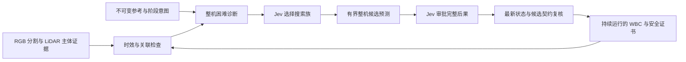

# 动态约束下保留运镜意图的可验证语义修复

研究对象是差动底盘与机械臂的连续运镜：动态障碍或整机构型限制使原始相机轨迹不可实现时，如何选择一个物理有依据、语义可接受的偏差，并检验执行是否兑现了选择。建议将论文主张限定为 **基于预测执行后果的意图条件化修复**。Jev、SAM2.1、LiDAR 和 ROS 的集成本身不是贡献；当前开发验证也未证明 Jev 优于规则策略。

建议英文题目：**Preserving Cinematic Intent under Whole Body Constraints through Verified Counterfactual Repair**。

## 问题与可证伪假设

外部输入仅为原始相机参考 `T_ref(t)`、shot phase、主体身份和简短意图。机器人状态、标定、点云和分割属于运行时证据；不要求用户提供视觉容差、障碍未来轨迹或允许修改的数值范围。原始时间轴和参考始终不可改写。

核心假设是：对于相同的可行修复候选，阶段、历史和意图会改变合理的视觉取舍。预测出的底盘与关节余量能够帮助避免“当前画面很好，但下一段镜头无法执行”的选择。如果阶段相关数值评分在相同候选、信息和预算下同样好，就不支持增加语义 Agent 的必要性。

另一个独立假设是：语义选择修复族能够在固定优化预算内减少无效搜索。如果均匀枚举同样好，就只保留最终候选选择，不应把第一次模型调用包装为必要创新。

## 只保留三个模块

感知模块只说明观测；数值模块生成和验证运动；唯一语义决策者选择取舍。没有多 Agent 协商、生成式世界模型、反事实图像渲染或另一路视觉伺服器。CPU 数学进程和模型线程均只有一个未完成任务，SAM 使用独立进程与单任务队列。安全控制不等待它们。

一轮通常只有两次 Choice：先选择 `framing / view / joint / restore` 修复族，再选择完整候选或拒绝。搜索族只是计算权限；真正的运动权限只来自绑定到具体轨迹哈希的最终选择。拒绝后底层继续检查原有目标的安全执行，不能把拒绝当作任务完成。

## 方法定义

记证据为 `e_t`，其中每项包含主体身份、采集时刻、来源与有效状态。令 `x_t` 为当前整机状态，`s_t` 为当前场景估计，`z_t` 为阶段与历史。模型先选择有限修复族 `a`，程序在同一个物理搜索域内生成候选 `delta_i`：

\[
\hat x_i(\tau)=\operatorname{Rollout}_{WBC}(x_t,s_t,T_{ref}\oplus\delta_i),
\qquad
\hat y_i(\tau)=h(FK(\hat x_i(\tau)),\hat s_t(\tau)).
\]

候选的比较对象是 **预测执行轨迹** 的视觉后果，而不是仅修改后的目标。点云仅提供当前观测与局部匀速预测，不输入仿真未来真值。目标、预测执行和实际执行保留各自的误差。

模型获得的后果卡包含屏幕位置偏差、距离尺度代理、相对观察方向、阶段进度、最差时刻、各阶段关节余量、净距和跟踪残差。物理通过是前置条件；最终取舍由意图决定，原始位姿误差只作为参照或数值基线。

最终批准绑定 `H(original, parent, delta_i, activation, blend, hold, recovery)` 和完整候选卡哈希。到达太晚的结果不再移动激活时刻；更小幅度、不同恢复过程、两个单独批准的方向组合，都需要新的完整候选批准。

### 简单的结果契约

初版采用“批准具体候选＋不恶化已批准的预测上界”，不让 Jev 生成精确视觉阈值。最新状态的重预测必须满足每项已知后果的全窗口与分阶段上界，另加固定的数值一致性余量。余量是预测器校准参数，不是用户镜头容差，也不能在线不断放宽以掩盖失败。当前默认值为构图 0.015、距离尺度代理 0.04、角度 0.03 rad、归一化阶段进度 0.04；正式实验前应在独立开发集标定并冻结，当前数值没有统计覆盖保证。

门禁分别记录 `physical_valid`、`target_authorized`、`predicted_visual_valid`、`state_fresh`、`observed_visual_valid`，取值为 pass、fail、unknown。未来遮挡未知不会被写成通过。若模型在明确知晓这些未知项的情况下批准了几何候选，系统可以执行，但不能宣称其完整视觉契约已获确认。批准时已知、后来丢失的观测支持会要求重新审批。

发生安全退让时仍以原始意图计分，不能扩大契约后把失败改判成功。当前扫掠证书只针对已观测几何与局部运动模型；它不是硬件或未观测环境的全局安全证明。

### 感知采取保守的最小实现

SAM2.1 从当前 RGB 图像提取质心、可见面积和边缘余量。面积下降不能被直接解释为距离增加。分割和主体关联不可靠、遮挡未知或截断时，尺度补偿证据不可用。默认在线观察器以人工初始化框和前一有效框逐帧提示官方图像预测器，不加载未来帧；它不是完整视频记忆跟踪，也没有解决通用身份重识别。[SAM2 官方实现](https://github.com/facebookresearch/sam2)

主体三维位置由独立运行时跟踪器提供。ROS 在 RGB 采集时刻查询相机 TF，并在有界几何历史中匹配采集时刻的主体观测，检查投影一致性；不能将 SAM 推理结束时的最新位置当成 RGB 中的位置。当前几何仍单独用于规划，失效或过期不能靠历史记录改判有效。LiDAR 已通过采集时刻 TF 进入世界系，不使用固定的末端相机与底盘 LiDAR 外参。必要时使用 `T_CL(t)=inv(T_WC(t)) T_WL(t)`。当前没有额外实现扫描去畸变、稠密重建或通用遮挡预测。

视觉参考来自不可变的原始轨迹与初始主体标定。在线主体状态只改变执行画面的条件预测，不把当前偏差重新定义为理想参考。Pan 使用角进度，Orbit 使用绕主体角进度，MoveIn/MoveOut 使用距离进度；完整多周绕行及大于半周的单阶段角运动需另做进度展开验证。几何尺度仍明确标为距离平方反比代理；不等同于未来完整主体掩膜面积或正面/侧面语义。

### 计算预算与适用窗口

默认至多 8 个便宜筛选提案、3 条完整分支，共同激活前缀只预测一次。筛选在激活之后计算，避免所有未生效提案得到相同评分。完整预测窗口最长 8 秒，允许配置但不超过 12 秒；长镜头的修改在窗口结束前平滑恢复，并触发后续事件，窗口之外不声称已经验证。

远期预测步长为 0.1 秒；安装复核在前 1.2 秒使用与当前 WBC 一致的 0.02 秒步长，再使用粗步长预测后缀。这减少了粗预测在安装时刻附近的状态偏差，但不构成模型误差的统计保证，也不能允许晚到结果重定时。

Agent 事件最小间隔默认 0.5 秒，不代表决策吞吐达到 2 Hz。当前默认预留 4 秒激活提前量，计算、网络和安装复核都必须在该时刻之前完成。该选择暴露了当前 CPU 全预测较慢的事实，不能作为实时性能优势。WBC 保持原有执行周期；SAM 默认最多 4 Hz，不积压旧帧。应报告真实决策完成频率、调用延迟和端到端延迟，而不是强求语义层达到 50 Hz。

## 三层验证即可

| 层次 | 要回答的问题 | 最少内容与停止条件 |
|---|---|---|
| 确定性回归 | 权限与时效边界是否正确 | 原参考不可变、精确绑定、晚到拒绝、未知不算通过、纯 Pan、主体移动、错误 TF、感知积压、共享前缀等价。任一失败先修复，不跑大规模实验。 |
| 受控闭环与故障注入 | 执行是否真的独立于 Agent | 强制延迟/断连、过期掩膜、身份不匹配、新障碍、障碍尺寸/速度改变；记录控制周期与拒绝原因。测试决策器明确标识，不称为 Jev 成果。 |
| 固定测试集与盲评 | 语义取舍是否值得引入 | 相同候选与预测信息、相同搜索预算、原始时刻配对、计入全部失败；独立人工意图评分。 |

先将无障碍名义轨迹通过率作为场景准入检查。名义 WBC 本来就无法完成的轨迹不适合用于证明 Agent 的语义收益；可以保留在压力测试，但必须单列。不得通过慢放仿真、暂停障碍或延长原始镜头预算改善成功率。

## 最小论文实验矩阵

建议冻结开发集之后，使用 3 类冲突、2 个难度、每格 10 个配对种子，共 60 个测试 episode。此规模是实验设计，不是本轮已经取得的样本数。

1. **同一几何，不同意图**：保留主体尺度与保留完整绕行角的冲突。仅替换意图文字，候选集保持一致。
2. **阶段耦合**：Orbit 到 Pan、MoveOut 到 Pan，当前误差小但后续关节余量不足，与当前稍有偏差但后续可完成的候选对比。
3. **感知歧义**：真实距离变化、局部遮挡、截断/过期分割。检验“面积下降就靠近主体”的错误是否减少；不能向 Agent 提供用于独立评分的未来遮挡真值。

主对照只需 strict、阶段相关数值规则、完整 Jev。strict 仍共享底层安全控制；数值规则同样看到阶段、历史、各候选的后果和下一阶段余量。再加入相同接口的通用语言模型做模型效率对照，避免把架构收益归因于某个品牌。

将两个实验拆开：

- **候选选择实验**：固定离线候选银行，随机排列候选顺序，各策略得到相同信息。`scripts/replay_decisions.py` 已提供 rule、pose、Jev 回放入口。仅比较选择、拒绝和延迟；选择一致率不是意图成功率。
- **搜索策略实验**：相同修复空间、相同候选数、相同 WBC 预测步数和墙钟上限。比较 Jev 指导与均匀/轮换枚举，允许各策略产生不同候选。仅相同“最大次数”还不够，必须同时记录实际调用数与耗时；均匀枚举闭环基线尚待补齐。

消融限制为三个：去阶段与历史、去后续阶段预测、去实时感知。去后续预测时还要去掉全局终点损失/全局关节余量中的信息泄漏。离线遮蔽感知只能测信息依赖；要证明感知改善了轨迹，必须重新运行不使用感知的闭环。

## 指标与统计

保留 Composition Error、Subject Scale Error、Observation Angle Error、Visual Smoothness。离线 SAM2.1 评价独立于在线 SAM 观察器；参考与执行按原始时刻配对。未来预测里的 range scale proxy 不可替换离线 mask scale metric。

静态测试场景的无遮挡参考在执行后单独渲染，避免逐帧切换机器人可见性污染参考。参考渲染协议、帧数、mask 面积突变与缺失均记录；异常先人工核验，不自动删除不利结果。移动主体需要额外的原始时刻场景回放协议，当前实现没有验证这一能力。

同时报告：全部运行的安全完成率、完整序列完成率、物理子步约束违反、碰撞/接触、无效感知占比、候选安装率、拒绝/超时/过期率、控制 p95/p99 与超时次数、成功和失败决策的端到端延迟。中止视频上的视觉均值只能标为“已执行前缀”，不能与完整视频平均值直接比较后宣称改善。

以 episode 而不是逐帧作为独立统计单位。配对种子报告差值及按 episode bootstrap 的 95% 区间，成功率报告区间，缺失观测单列。先报告安全/完成，再报告有效观测上的连续误差；避免用单一加权总分掩盖失败。

独立评价器的 Pan 进度必须使用旋转，不能用近乎不变的相机位置匹配时间。协议 v1.1 修正这一诊断，未改变完成阈值或原时刻视觉评价。组合测试的角运动幅度应大于完成容差，避免不执行 Pan 也能达标。当前新编写的 Orbit→Pan 夹具及本轮数值优化、感知测试和失败记录见 [优化报告](results/optimization_20261013_0835/REPORT.md)；开发速度提升和名义夹具通过不作为语义收益证据。

盲评给出原始意图和两个匿名视频，左右随机、隐藏方法名称；选“更符合意图”并允许平局。不同意图采用同一几何对照，至少三名独立评分者，按 episode 聚合。预注册评价问题和排除规则，不能仅挑成功视频。

## 相关工作与新颖性边界

语言选择可执行技能已有 [SayCan](https://arxiv.org/abs/2204.01691)，语言生成空间目标已有 [VoxPoser](https://arxiv.org/abs/2307.05973)。[PAMPC](https://arxiv.org/abs/1804.04811) 已将感知质量与运动预测联系起来；不能将“考虑视觉和动力学”本身称为新贡献。

语义运镜也已有直接先例：[Batteries, camera, action](https://arxiv.org/abs/2011.10118) 学习语义描述到相机参数的映射并做人类评价；[LIME](https://arxiv.org/abs/2607.02417) 从图像和语言意图生成下一观察位姿；[CinemaTraj](https://cinematraj.github.io/) 研究语言驱动的原子相机轨迹组合。论文不能声称首次用语言规划相机运动。

可争取的区别是一个更窄的联合问题：**给定不可变相机参考和固定时间预算，在动态障碍及差动整机限制下，根据预测实际执行及阶段后果选择可接受修复，并显式审计批准和执行之间的差距。** 这属于待通过相关工作全文与实验确认的贡献定位，不是已证明的首创声明。

建议正文只列两项贡献：后果驱动的修复决策表示，以及分离语义许可与物理执行、可统计预测兑现程度的验证协议。精确哈希、双 Python 环境和 ROS 通信属于实现细节，放在系统实现或补充材料。

## 论文结构与当前结论

正文按 Problem → Counterfactual Repair → Verification → Experiments → Limitations 展开。主图展示一次真实冲突中三个候选的视觉代价与后续余量；主表比较同候选条件下的意图保留与安全完成；第二张图展示不同预算下的质量与延迟。只有经验证的实际提升才进入摘要中的结果句。

当前代码具备验证这条假设的机制，但当前动态 PhysX 场景仍存在底层执行失败，真实 Jev 也可能拒绝全部候选。若改进后的数值基线已经足够、未来预测没有可重复收益、或者新方案只在慢放仿真中有收益，应缩减论文主张或放弃该方向，而不是继续增加模块。
