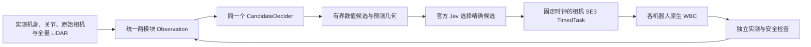

# 五机器人统一避障接入与官方闭环结果

Husky + UR5、Ridgeback + UR5、TIAGo、G1、Go2 + Piper 已接入同一个官方 Jev 决策流程与统一两模块 Representation。**尚未达到五机器人、十组场景全部通过的目标。** 最后一轮固定配置测试有 3/10 组安装了官方精确选中的轨迹，完整物理验收 0/10，墙钟实时性 0/10。其中 1 组属于官方网络未验证，不计作已证实的测试失败。

本轮两小时窗口为 **2026-10-21 北京时间 10:30:17–12:30:17**；本报告生成于 2026-10-21 12:26:11 GMT+8。官方项目数据调用已获用户明确授权，见 [AGENTS.md](AGENTS.md)，没有再次请求授权。固定端点 `https://api.typesafe.ai/v1/systemone`、模型 `jev-1.14.0`，密钥从仓库根目录 `typesafe_Jev_api_key` 读取；日志不保存密钥。

## 最后一轮完整比较

来源为 `results/five_robot_jev_20261021/final_official11/`。每组均使用真实 Isaac Sim、原有原生 WBC、100 Hz 物理、`pace=1` 和完整 LiDAR 光束。Jev 的策略、配置、精确选择通过真实官方 API 完成。下表是同一配置的一轮结果，没有拼接历史最佳成绩。

| 机器人 | 运镜 | Jev 精确轨迹已安装 | 位置 RMS / cm | 完整物理验收 | 未通过或未验证项 |
| --- | --- | --- | ---: | --- | --- |
| husky | orbit | 是 | 2.46 | 未通过 | 运镜质量 |
| husky | movein | 否 | 2.86 | 未验证（网络） | 官方网络未验证、运镜质量 |
| ridgeback | orbit | 否 | 6.35 | 未通过 | 未安装 Jev 轨迹、跟踪 |
| ridgeback | movein | 否 | 7.00 | 未通过 | 未安装 Jev 轨迹、跟踪 |
| tiago | orbit | 否 | 4.23 | 未通过 | 未安装 Jev 轨迹、跟踪、原生约束、运镜质量 |
| tiago | movein | 否 | 7.58 | 未通过 | 未安装 Jev 轨迹、跟踪、原生约束、运镜质量 |
| g1 | orbit | 是 | 3.49 | 未通过 | 原生约束、停止、运镜质量 |
| g1 | movein | 否 | 6.88 | 未通过 | 未安装 Jev 轨迹、原生约束、停止、运镜质量 |
| go2 | orbit | 否 | 26.41 | 未通过 | 未安装 Jev 轨迹、跟踪、实测间距、环境连续证据、原生约束、停止、运镜质量 |
| go2 | movein | 是 | 10.63 | 未通过 | 跟踪、运镜质量 |

跟踪门槛同时检查 RMS 与终点：Husky / Ridgeback / TIAGo 为 3 cm、0.08 rad；G1 / Go2 放宽为 8 cm、0.20 rad。未安装 Jev 轨迹时，跟踪误差对应原始参考的安全执行尝试，不能算作 Agent 避障成功。完整物理验收还要求原生约束、环境证据、严格停止、运镜保真度及精确轨迹绑定通过；实时性单独报告。

[逐项报告](results/five_robot_jev_20261021/final_official11_report/report.json) · [CSV](results/five_robot_jev_20261021/final_official11_report/comparison.csv) · [误差图](results/five_robot_jev_20261021/final_official11_report/tracking_comparison.png) · [验证清单](validation/five_robot_official_20261021/final_manifest.json)

本轮较早的独立试验中，Husky orbit 在 `official_height_gc08`、`official_native09` 通过完整物理验收；Ridgeback orbit 在 `official_native09` 通过。G1 orbit 在 `official_height_gc08` 完成官方轨迹安装、放宽跟踪与环境间距检查，但严格停止、驱动证据和运镜质量未全部通过。这些记录用于判断改动和重复性，不能替代上表中的最后一次结果。

## 公共边界与修改范围



- 公共表示保留 `T_world_mount`、`T_mount_camera` 的完整 6D 位姿，以及 `mobile_platform` / `camera_manipulator` 两个模块的保守占用。障碍表面间距、方向、采集时间、预测作用域和未知状态显式区分。原始机身倾斜、高度和物理相机没有被虚拟稳定相机替换。
- 原生 USD 关节轴、实测姿态和相机外参构建私有 PoE / OBB 模型。机器人名字、关节顺序与控制向量不进入 Jev 的公共几何证据。预测几何不是动力学或力矩证书。
- 精确候选哈希、0.04 秒执行节点、线性位置插值与 SLERP 姿态插值绑定同一条轨迹。安装前重新检查新鲜地图、实测相机残差、观测有效期和原生预测间距；迟到轨迹拒绝执行，不能重新定时后自动启动。
- `CandidateDecider` 的策略 → 配置 → 精确选择逻辑保持不变。`engine.py`、`representation.py`、`wbc_protocol.py` 与 HEAD 字节相同。`jev.py` 有两处可选 HTTP 传输入口改动，以复用官方 HTTPS 连接；不能声称该文件字节未变。类型检查、问题、验证、重试、脱敏及选择逻辑保持原样，见验证清单中的源代码证明。
- 公共证据补充原始运镜在当前 mount 坐标系内的几何意义、候选的明确位移程序和前次有界搜索结果。更新数值观测时同步更新参考坐标系；局部搜索失败不会被写成全局不可行。

## 本轮保留的实现优化

数值筛选使用独立进程；全向模型使用有界 Gauss–Newton，非完整模型保留 SciPy TRF 并编译相同残差。FK、OBB 距离、Jacobian 与可见性投影使用预热的 Numba 内核，保留参考实现、有限差分与投影一致性检查。官方 HTTPS 连接池只允许固定端点、TLS 验证和原超时，不自动跟随重定向。日志序列化可与已经完成硬筛选后的最终选择请求重叠。

预滚动的数值构造最早在原始开拍前 2.1 秒取得新鲜数据；原始开拍时刻和 0.9 秒激活提前量不变。候选仍使用现有 C² 变形及固定终点时钟公式；公共时间重分配种子为 ±0.7，所有机器人使用相同规则。联合候选包含径向/高度组合、纯径向和纯下降四个空间种子，仍与两个时间种子合计六个提案；候选位移预留 5% 的跟踪余量，实测验收门槛不变。所有界限和最后的种子调整均随每次运行冻结。

- **Husky**：原生 OCS2 SLQ；准备阶段底盘朝向软权重由 20 降为 5，减少开拍时相机偏差。原差速轮、侧滑标定、驱动和安全门槛保留。
- **Ridgeback**：原生 OCS2 SLQ；复用同一相机路径、0.25 秒内且已通过硬检查的策略作为热启动；环境软提前距离由 85 mm 调到 140 mm，硬间距仍为 25 mm。
- **TIAGo**：保留 Giskard World / MotionStatechart / Executor / PIQP。保持之前的真实关节相机准备、关节停止保护及抗积分饱和。已安装计划可向原生 WBC 提供私有预测姿态和底盘朝向软偏好，相机任务与所有原生约束保持优先；该预测不能当作实测安全证据。此软偏好只会在官方计划成功安装后生效；未安装的试验不能验证它的物理收益。
- **G1**：保留 Pink 和原腿部策略，60 ms 指令租期、180 ms 恢复期限不变。物理循环前准备长期存活的仿真对象，在单段有限运行内延后全历史循环扫描；新对象的年轻代回收和引用计数继续工作，退出时恢复 GC 设置。修复不完整停止窗口掩盖真实错误的问题。
- **Go2**：保留原 LeggedManip 检查点与原生工作空间。运动预测、输入变化率和环境约束继续生效；当前仍存在原生策略工作空间与跟踪能力不足，未用通用控制器替换检查点。

## 场景、安全与未解决限制

两个 authored demo 均保持原始 **8 秒**、球半径 **0.1 m**、水平路径和速度大小 `hypot(0.035, 0.24)`。初始实测相机决定统一重力保持配准；额外障碍高度校准为 Ridgeback −8 cm、TIAGo +8 cm、Go2 −8 cm，Husky / G1 为 0。只移动障碍物高度，不改相机参考或被摄主体。每组 `scenario_binding.json` 保存完整来源和场景哈希。

[独立场景挑战审计](validation/five_robot_official_20261021/scenario_challenge_audit.json) 使用 authored 场景复核原始相机刚性附件的间距；这是事后审计，数据不会进入规划器。它不等价于完整关节机器人沿名义轨迹的动力学证明。

以下门槛未放宽：每次 6 个提案、最多 2 次全路径筛选、18 秒候选计算预算、0.9 秒激活提前量、4 秒源预测有效期、0.25 秒地图有效期、25 mm 环境间距及原生关节/速度/自碰撞保护。完整扫描覆盖与采集时间戳保留，物理时钟不会等待 Agent。

主要限制仍是：官方最终选择时延可能超过激活窗口；私有运动学可行不保证原生动态控制可行；部分机器人缺少完整原生约束证据；G1 / Go2 的原始相机振动与停止行为影响运镜质量。`pace=1` 不等于已达墙钟实时性，最后一轮实际比率见报告。没有以网络失败、诊断曲线或历史最佳结果补齐通过率。

## 复现与验证

```bash
/home/w84384651/miniconda3/envs/env_isaaclab/bin/python \
  ros2_ws/jev_agent_wbc/scripts/run_multi_robot_avoidance.py \
  --mode jev --max-minutes 120 \
  --obstacle-height-offsets ridgeback=-.08 tiago=.08 go2=-.08 \
  --output /tmp/five_robot_official_new
```

输出目录必须是新目录。依赖沿用现有 Isaac、OCS2、Giskard、Pink、LeggedManip 安装。原生 OCS2 构建使用 `scripts/build_multi_robot_avoidance.sh` 的独立 `avoidance` 缓存，不覆盖历史后端二进制。

本轮基础回归 **596 passed / 7 skipped**，最后细化后的相关回归另行通过；这些复测有重叠，不相加计算独立测试数。两个 OCS2 后端共 4 项 CTest 通过，Husky / Ridgeback 的环境、相机与动态导数独立有限差分通过。命令、日志、代码快照和哈希见 [验证目录](validation/five_robot_official_20261021/test_commands.json) 与 [原生导数证明](validation/five_robot_native_gradient_20261021.json)。单元测试不是物理验收。

所有历史结果、冻结代码和失败日志保留。此前无官方 Jev 的 `final_shared_candidate38` 为 7/10 跟踪、0/10 完整物理通过；`final_native_matrix31` 为 9/10 跟踪、0/10 完整物理通过，均不计入本轮 Agent 成功率。历史报告位于 `results/five_robot_avoidance_20261020/`。本轮未生成交付视频。

周剩余额度降到 2% 时，上一轮已按授权使用一次指定重置机会，本轮没有再次使用；见 [额度记录](validation/five_robot_quota_reset_20261021.json)。
