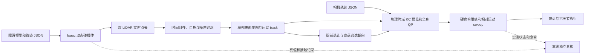

# KC WBC 动态 LiDAR 避障

新增 `jvs_kc_wbc_dynamic_trajfollow.launch.py`，与现有静态
`jvs_kc_wbc_trajfollow.launch.py` 并列。它跟随已有相机轨迹，通过前后 LiDAR
在线重建局部表面、估计移动障碍速度，并在同一个全身控制 QP 中处理底盘和机械臂的动态避障。
原有静态 trajfollow 入口继续保留，动态运镜时钟只用于动态控制器。



真值和障碍物文件只进入仿真及离线复核，控制器的场景输入来自 LiDAR。

## 2026-10-09：combo4 的 8–10 秒横滚修复

原四宫格中的摇摆来自真实控制命令：避障结束后继续追赶 MoveOut 参考，
腕部关节余量耗尽，底盘和机械臂受到加速度限制而无法抵消相机横滚。
原 7–11 s 实测相对参考横滚峰值为 3.545°。仅检查相对低通趋势的
1 / 3 Hz 高频残差会漏掉这种慢速偏转。

`shot_combo4.json` 及动作版新增仅供动态控制器使用的
`dynamic_camera_tracking`：姿态代价放大 100 倍、位置误差恢复速度上限
0.4 m/s、关节限位前 0.15 rad 的软回正区域（代价 10000）。这些是同一
全身 QP 中的软目标；原碰撞、关节、轮速和加速度硬约束不变。参考样本、
动作时长、出生位置和障碍路线均未修改，也未增加命令或画面滤波。
生成器保留该配置。动作版仅通过生成及配对测试，尚未重新做独立物理运行。

完整物理运行保存在 `results/combo4_horizon_fix_20261009/recovery40/two_movers`，
运行期间输入源哈希未变化。新增 `scripts/audit_camera_reference.py` 在真实
物理时间上比较相机与轨迹姿态，要求完整运行，并独立检查请求窗口与全部动作段。

| 检查 | 修复前 | 修复后 |
| --- | --- | --- |
| 7–11 s 相对参考横滚峰值 | 3.545° | 0.073° |
| 7–11 s 横滚 RMS | 1.329° | 0.035° |
| 全部动作段横滚峰值 | 3.545° | 0.095° |
| 动作段控制采样位置 RMS / 峰值 | 1.20 / 4.16 cm | 1.62 / 5.82 cm |

30 / 60 / 1000 Hz 未滤波物理相机抖动检查及固定动作时长检查均通过，
机器人与动态障碍、机器人与静态物体、障碍与静态物体三类接触事件均为零。
252 项包测试通过。相机回放与逐步物理姿态的最大差异为 0.0012 mm / 0.000039°。
位置峰值仍超过原 5 cm 标准，严格动态验收中的精度、物理执行器及运镜分配
检查仍未全部通过；此次结果证明相机摇摆修复，不代表全部算法验收通过。

对比图：[真实相机姿态与位置误差](results/combo4_horizon_fix_20261009/camera_comparison.png)。
详细指标见同目录 `final_reference.json`、`final_stability.json` 和
`recovery40/two_movers/dynamic_report.json`。新视频单独保存，历史视频保留。

新录制为 41.80 s、30 fps、1920 × 1252、1254 帧，完整解码通过。
第一人称画面的高频运动检查通过（平移残差 RMS / 峰值 0.089 / 0.670 px）。
[6–12 s 第一人称前后对比](results/combo4_horizon_fix_20261009/video/combo4_before_after_6_12s.mp4)；
[完整同步四视角](results/combo4_horizon_fix_20261009/video/two_movers_combo4_quad_view.mp4)。

## 2026-10-08 运镜动作固定时间更新

动态控制器的 Orbit / Pan / MoveOut 动作按轨迹中定义的时长推进，
障碍接近和跟踪误差不再降低动作段的路径速率。初始获取、衔接准备和末端
停留仍采用已有自适应处理。动态距离预测、相对运动硬约束、提前退让、
逃逸朝向及连续命令 sweep 均保留。后台预览按物理时间以 0.2 s 目标间隔
提交任务，仍使用 8 × 0.4 s 预测时域，并保持单个异步任务在途。

`reference.json` 的 `motion_timing_mode=fixed_physical_time` 标识新行为。
独立验收要求动作段速率为 1、轨迹增量与物理时间一致，且每段实际时长
符合配置；不再要求旧版本的时间让行事件。旧报告仍按其原验收方式读取。
下文 2026-10-06 / 2026-10-05 的记录保留为含时间让行的历史结果。

动态执行的相机误差反馈增益由 4 调到 8，静态控制器仍为 4。
动态目标进入底盘制动范围时，增加相对接近速度的提前制动约束；
目标暂时停止也不会撤掉这项约束。补充约束使用原有碰撞及执行器
约束内的共同可行控制确定上限，保留原有硬约束和命令 sweep 检查。

动态执行 QP 的 OSQP 无解证书精度收紧到 `1e-8`，静态控制器保留
原默认 `1e-4`。实际横穿场景中，一组近似平行的表面约束曾被误判
为无解，独立线性规划确认该组原约束可行；收紧证书精度后，由既有
精细重求解流程处理，最终仍须通过原始硬约束残差门。对应真实失败
快照和回归测试保存在 `test/fixtures/dynamic_qp_false_infeasibility.json`
和 `test_dynamic_avoidance.py`，全包 207 项测试通过。

用户随后明确要求“放宽验收标准，直接先发布视频”。因此本次视频
发布使用 `record_dynamic_dual_view.py --allow-nonstrict-source`，要求来源
运行完整结束且无运行失败，保留 `dynamic_demo_pass`、精度、间距及
物理执行器检查的原始结果。严格验收门限没有被改写；完成录制不
表示通过严格算法验收。双视角录制使用 30 fps、1920 × 664，
每条完成后验证完整解码和标注，再覆盖原视频。旧视频及记录备份在
`results/dynamic_no_time_yield_20261008/video_backups`。

更换下文 combo1 / combo3 障碍轨迹前的实测和视频发布记录在
`results/dynamic_no_time_yield_20261008/final_runs` 和
`results/dynamic_dual_view_20261008_1148/*_video_validation.json`。
临时阻挡复核使用无障碍实测基线，在相同相机轨迹进度比较底盘
几何，并核对底盘绕行或停车时机械臂继续跟踪；基线和真值只用于
离线复核。基线反馈增益为 4，当前动态控制器为 8，因此该比较说明
几何阻挡与实际响应，不是控制器参数完全相同的因果消融实验。

更换下文障碍轨迹前，三个视频的发布记录如下，均包含停止尾段：

| 视频 | 时长 | 运镜位置 RMS / 峰值 | 文件 |
| --- | --- | --- | --- |
| 第 1 条：双障碍 / combo4 | 42.33 s | 1.21 / 4.15 cm | [同步四宫格](results/dynamic_dual_view_20261008_1148/two_movers_combo4_quad_view.mp4) |
| 第 2 条：交叉小车 / combo3 | 42.50 s | 1.37 / 3.77 cm | [同步双视角及实测路径](results/dynamic_dual_view_20261008_1148/overtake_combo3_dual_view.mp4) |
| 第 3 条：立柱阻挡 / combo1 | 38.93 s | 3.40 / 12.38 cm | [同步双视角](results/dynamic_dual_view_20261008_1148/crossing_combo1_dual_view.mp4) |

三条均完整运行、通过固定动作时长及临时阻挡复核，三种接触事件均为零。
动态间距或物理执行器等严格检查仍未全部通过，第 3 条的峰值位置误差
也超过原 5 cm 门限；这些失败项随原始报告保留。本表对应用户授权的
放宽发布，不作为严格算法验收通过声明。新增路径小图后，录制标注的
5 项测试也全部通过。

combo4 的四宫格版本通过 `record_dynamic_dual_view.py --layout quad`
重放同一份实测数据生成，没有修改相机参考轨迹、障碍物路线或实测状态。
左上、右上保留第一人称和原环境视角，下方新增相对初始底盘朝向的固定
左侧、右侧第三人称视角。每格 960 × 540，加标注后整体 1920 × 1252，
仍为 30 fps、1270 帧；原视频链接也覆盖为该四宫格版本。

## 2026-10-09：combo1 横向柱与 combo3 三次同步横穿

combo1 保留已验证的水平柱轨迹：长 40 cm、直径 5 cm，中心高度 65 cm，
8–11.5 s 缓慢进入机械臂通道，13.5 s 撤回，最大速度 0.1725 m/s。
同一物理时刻的无障碍基线在 11.117–12.317 s 与 link3 实体重叠；既有闭环
记录确认在继续运镜时调整了机械臂姿态（冲突期间关节差异范数最大 0.754 rad）。
本次核对了相机参考轨迹和障碍配置与该记录一致，没有改动运镜参考。

combo3 的 `dynamic_overtake.json` 改为三次横穿。小车在 3–9 s 完成第一次
横穿，在 16–23 s 反向横穿，在通道外调整 x 位置后于 28–35 s 第三次横穿，
最后停在通道外。小车尺寸仍为 20 × 18 × 24 cm，最大速度约 0.3112 m/s。
轨迹时间均为控制器启动后的物理仿真时间；每段采用零端点速度的平滑插值。

对与当前相机轨迹逐字节一致的完整无障碍实测基线进行实体核验：

| combo3 阶段 | 无动态避障时的独立实体碰撞窗口 | 持续时间 |
| --- | --- | --- |
| Pan | 5.850–6.850 s | 1.017 s |
| MoveOut | 18.333–21.450 s | 3.134 s |
| Orbit | 29.750–32.416 s | 2.683 s |

每个窗口均要求实际底盘 STL 凸包与障碍物在同一时刻穿入至少 5 mm，且连续
至少 0.1 s，不能用三个过短片段累计或错时的路径交叉代替。核验脚本新增
`--min-encounters 3`；默认仍为一次。实际测量片段及来源哈希保存于
`test/fixtures/nominal_dynamic_encounters`，回归检查覆盖两条正式场景配置。

完整几何报告位于 `results/dynamic_repeated_encounters_20261009`。使用所有
USD 来源层哈希均未变化的家具表面参考检查，combo1 / combo3 的保守家具
间隙分别为 0.569 / 0.421 m。当前环境无法连接 NVIDIA 驱动，本轮未重新执行
Isaac 闭环仿真；combo3 三次避障的运镜误差和接触结果仍待验证。下面的
2026-10-08 视频和闭环结果只对应旧的一次横穿，不能作为新三次横穿的验收结果。

复核 combo3 三次碰撞（从仓库根目录执行）：

```bash
PYTHONPATH=ros2_ws/jvs_mock python3 ros2_ws/jvs_mock/scripts/audit_counterfactual_collision.py \
  --baseline ros2_ws/jvs_mock/results/dynamic_collision_required_20261008/baseline_frozen/overtake \
  --scene ros2_ws/jvs_mock/scenes/dynamic_overtake.json --body base --min-encounters 3 \
  --output /tmp/combo3_repeated_collision.json
```

## 2026-10-08：combo1 / combo3 的真实碰撞场景记录

最新的相机参考轨迹未改动。combo1 使用长 40 cm、直径 5 cm 的水平圆柱，
位于 65 cm 的机械臂高度。它在首段 Orbit 后段缓慢接近机械臂，再移开，
最大平移速度为 0.1725 m/s。combo3 使用 20 × 18 × 24 cm 的小车，
在 Pan 中从侧面横穿底盘未来通道，最大速度为 0.2875 m/s，随后离开后续通道。

本轮在 `results/dynamic_collision_required_20261008/runtime_snapshot` 固定
一套控制和仿真配置，分别运行完整的无障碍基线和避障场景，以免工作区的
并行修改污染前后比较。配置使用动态反馈增益 8、1000 Hz PhysX、PGS、
力型关节驱动刚度 1000 和阻尼 100；具体命令和源文件 SHA256 位于各运行的
`run.json`。无障碍基线将测试 actor 放在局部地图之外，保留原有房间和控制器。

新增 `scripts/audit_counterfactual_collision.py` 对照同一物理时刻的无障碍
实测机器人姿态和候选障碍实体。机械臂使用实际 URDF link1–link6 圆柱，
底盘使用实际导入 PhysX 的 `base_frustum.stl` 凸包，避免将底盘的外包圆台
近似当作实体。证明不扣除安全缓冲或表面采样覆盖半径；至少 5 mm 的实体
穿入持续 0.1 s 才通过。因此，只有历史位置重合或安全缓冲区重合无法通过。
这属于离线实测基线几何对照，没有执行故意碰撞的物理实验，基线和障碍
真值不进入在线控制器。

当前实体碰撞证据及闭环结果：

| 场景 | 无避障实体重叠区间 | 最大实体穿入 | 实际运镜位置 RMS / 峰值 |
| --- | --- | --- | --- |
| combo1 水平柱 / link3 | 11.117–12.317 s，约 1.217 s | 2.33 cm | 2.88 / 9.15 cm |
| combo3 未来横穿 / 底盘 | 5.850–6.850 s，约 1.017 s | 5.60 cm | 9.08 / 35.24 cm |

两条避障运行都完整结束，三类 PhysX 接触事件均为零，动作段路径速率保持 1。
combo1 在冲突窗口中的机械臂六关节姿态差异范数达到 0.754 rad；该姿态比较
采用相同相机轨迹进度，实体碰撞证明始终采用相同物理时间。
新轨迹可用于展示真实避让，但位置峰值、运动 track 等严格检查仍未全部通过。
combo1 的水平柱在本轮没有形成可靠的移动 track，主要依靠实时表面地图和
全身碰撞约束完成避让；不能将该结果写成速度预测通过。视频保留原精度
和严格失败项，按用户授权的放宽演示要求发布。

当前来源为 `results/dynamic_collision_required_20261008/final_runs`，视频覆盖到
`results/dynamic_dual_view_20261008_1148` 和 `results/dynamic_interaction_20261008/videos`。
combo4 保留已发布的同步四宫格和原轨迹。旧视频备份在本轮结果目录的
`backups` 中。本轮使用可选 `--texture-memory-fraction .06` 限制 RTX 纹理
显存，保留 1920 × 664、30 fps 的同步双视角与真实误差标注。

圆柱模型新增可选 `axis: x|y|z`，默认 `z`；方向定义在初始底盘坐标系。
Isaac 碰撞体、视频重放、独立实体检查及家具预检使用同一方向。对应模型、
错时历史路径、仅缓冲区重叠、隔离源文件一致性和底盘外包近似检查均有回归测试。
本轮最终全包 227 项测试通过，日志位于
`results/dynamic_collision_required_20261008/pytest_final.log`；发布汇总及精度限制
位于同目录 `release_summary.json`。

## 构建和启动

以下命令从仓库根目录运行。输出目录必须是新的，避免混入旧日志。

```bash
source /opt/ros/humble/setup.bash
cd ros2_ws
colcon build --symlink-install --packages-select jvs_mock
cd ..
source ros2_ws/install/setup.bash
```

一次启动三个报告场景，分别运行 combo1、combo3 和 combo4，并录制 Isaac 俯视视频：

```bash
ros2 launch jvs_mock jvs_kc_wbc_dynamic_trajfollow.launch.py \
  stage_view:="$PWD/cinema_traj_out/kujiale_0021_kid_combo/simview/simview.usda" \
  demo:=all headless:=true record:=true real_time_factor:=0.2 timeout_s:=2400 \
  output_directory:=/tmp/jvs_dynamic_report
```

指定相机轨迹和障碍物轨迹文件：

```bash
ros2 launch jvs_mock jvs_kc_wbc_dynamic_trajfollow.launch.py \
  stage_view:="$PWD/cinema_traj_out/kujiale_0021_kid_combo/simview/simview.usda" \
  trajectory_file:="$PWD/ros2_ws/jvs_mock/trajectories/shot_combo1.json" \
  obstacle_trajectory_file:="$PWD/ros2_ws/jvs_mock/scenes/dynamic_crossing.json" \
  headless:=true record:=true real_time_factor:=0.2 timeout_s:=2400 \
  output_directory:=/tmp/jvs_dynamic_custom
```

不指定 `trajectory_file` 时，依次运行现有全部八个 combo JSON：combo1 的采样版、
combo1 的 `_actions` 版、combo2 的两种版本，直到 combo4。每次重新启动仿真和控制器，
根据该轨迹的 `initial_base_pose` 复位机器人，并重新开始障碍物轨迹。
采样版和动作版采用同一个动态控制器。`demo:=all` 则选择下表的三个报告预设。

`stage_view` 是必填参数，缺失或文件不存在时在启动仿真前退出。
当前三个障碍预设适配上面的完整公寓 USDA，使用绝对 `scene_y_up` 坐标；
换用其他 combo 的初始朝向不会把障碍移到茶几或沙发内部。
Isaac 引用完整场景及其资产，并将 Y-up 坐标 `(x,y,z)` 转为 Z-up `(x,-z,y)`。
家具在新仿真 stage 中固定于原始姿态，原 USDA 和引用资产不被修改。
可显式指定其他 USD/USDA，需要重新检查该场景与障碍轨迹的兼容性。
`headless:=false` 打开 Isaac 窗口，`record:=true` 保存真实仿真画面。
默认 ROS domain 为 226，物理频率为 1000 Hz，单次运行墙钟超时为 1800 秒。

也可分开启动仿真和控制器。两端的轨迹、domain 和 spawn 必须一致：

```bash
ros2 launch jvs_mock jvs_kc_wbc_dynamic_isaac.launch.py \
  stage_view:="$PWD/cinema_traj_out/kujiale_0021_kid_combo/simview/simview.usda" \
  trajectory_file:="$PWD/ros2_ws/jvs_mock/trajectories/shot_combo1.json" \
  obstacle_trajectory_file:="$PWD/ros2_ws/jvs_mock/scenes/dynamic_crossing.json"
```

```bash
ros2 launch jvs_mock jvs_kc_wbc_dynamic_controller.launch.py \
  trajectory_file:="$PWD/ros2_ws/jvs_mock/trajectories/shot_combo1.json" \
  output_directory:=/tmp/jvs_dynamic_single
```

## 三个报告场景

| 预设 | 相机轨迹 | 障碍物文件 | 场景行为 |
| --- | --- | --- | --- |
| `crossing` | `shot_combo1.json` | `dynamic_crossing.json` | 长 40 cm、直径 5 cm 的水平柱在 65 cm 高度接近机械臂，世界坐标 x=4.10 m，8.0–11.5 s 从 z=1.40 移至 1.17 m，13.5 s 移回；无避障时在 Orbit 后段撞入 link3。 |
| `overtake` | `shot_combo3.json` | `dynamic_overtake.json` | 20 × 18 × 24 cm 小车在 Pan、MoveOut、Orbit 阶段三次横穿底盘通道：3–9 s 从 `(3.98, 1.15)` 到 `(3.98, 2.30)`，16–23 s 返回 `(3.90, 0.85)`，28 s 前移至 `(3.65, 0.85)`，28–35 s 横穿至 `(3.65, 2.15)`。三次均与无避障底盘在同物理时刻实体相交。坐标为公寓世界坐标的 `(x, z)`。 |
| `two_movers` | `shot_combo4.json` | `dynamic_two_movers.json` | 直径 16 cm、高 24 cm 的立柱在 MoveOut 中进入底盘通道，6.8–7.0 s 暂停，8.8 s 撤离；另一台 22 × 20 × 32 cm 小车在旁侧空闲区域往返，保留两个独立运动 track。 |

所有障碍都采用有限尺寸，房间保留绕行空间。预设轨迹从公寓绝对坐标系定义，
场景运动按物理仿真时间推进，相机动作段保持固定时间推进。
当前三个预设的最大障碍速度分别约为 0.1725、0.2875 和 0.517 m/s。
最新 combo1 / combo3 独立家具预检位于
`results/dynamic_collision_required_20261008/candidate_crossing_late_end_preflight.json`
和 `candidate_overtake_lateral_a_preflight.json`；全路线间距下界分别约为
56.86 和 42.14 cm。

更换轨迹前，第二条的实测中心路径曾在世界坐标约 `(3.504, 2.005)` 相交：
底盘在 5.359 s 经过，小车在 8.777 s 穿过同一位置，两个通过时刻不同。
3.5–6.95 s 存在无障碍基线底盘通道的几何阻挡；实际底盘相对该基线
横向偏移最多约 10.4 cm，并有约 0.183 s 的停车同时机械臂跟踪片段。
基线与当前控制器增益不同，上述结果只作为几何和实测响应证据。
对应 `path_intersections.json`、`blockage_report.json` 保存在当前
`final_runs/overtake` 中。该条视频开启 `--path-inset`，黄色与蓝色分别表示
实测底盘、小车已经走过的路线；小图不会提前绘制未来路径。

以下采样间距、路线间距及场景组合检查属于 2026-10-06 历史输入，
不用于声称当前三个阻挡场景通过闭环严格验收：
独立 USD 网格预检采用 2 cm 表面采样，并扣除覆盖与时间采样误差。
四个模型与家具的全路线间距下界分别为 4.335、12.034、34.566、10.680 cm；
预检也包含公寓中的人物模型。最终输入、213 个 USD 源层 SHA256 和几何参考位于
`results/dynamic_usda_report_apartment_20261006/` 的 `scene_preflight.json`
和 `static_reference.npz`。双障碍路线的模型间距预检下界为 7.212 cm，
对应 `obstacle_pair_preflight.json`，两台障碍不会在运动中相互穿透。
当前报告目录的 `scene_catalog_preflight.json` 进一步检查了三个障碍文件与八个 combo
的 24 组几何组合，包含小车随初始底盘朝向旋转后的间距，全部通过 2.5 cm 家具间距下界。
这项检查只验证障碍路线与静态场景的兼容性；机器人闭环实测仍限于下表三个报告预设。

### 2026-10-06 完整公寓报告结果

三例在用户指定的 `cinema_traj_out/kujiale_0021_kid_combo/simview/simview.usda`
中分别完整执行，使用相同版本的动态控制器和 Isaac runner、最终障碍文件、
双 LiDAR、1000 Hz 物理步长和 `real_time_factor:=0.2`。
结果位于 `results/dynamic_usda_report_apartment_20261006/`。

| 场景 | 相机 RMS / 峰值（cm） | 动态 / 家具间距下界（cm） | 命令 sweep 下界（cm） | 完成时间（s） | 报告视频 |
| --- | --- | --- | --- | --- | --- |
| 横穿立柱 / combo1 | 0.589 / 1.653 | 5.994 / 16.794 | 4.286 | 91.400 | [视频](results/dynamic_usda_report_apartment_20261006/crossing/demo_report.mp4) |
| 侧向小车 / combo3 | 1.933 / 3.859 | 11.679 / 33.596 | 5.586 | 125.367 | [视频](results/dynamic_usda_report_apartment_20261006/overtake/demo_report.mp4) |
| 双障碍交会 / combo4 | 0.678 / 2.295 | 15.695 / 39.771 | 12.394 | 90.367 | [视频](results/dynamic_usda_report_apartment_20261006/two_movers/demo_report.mp4) |

[四页汇总 PDF](results/dynamic_usda_report_apartment_20261006/dynamic_demo_report.pdf)
和每例的 `report.pdf` / `report.png` 可直接用于报告。
视频保留原始 Isaac 场景像素，在画面外添加同步相机误差、全身间距及让行指标，
使用浏览器可播放的 H.264。全部数值及判定保存在
[汇总 JSON](results/dynamic_usda_report_apartment_20261006/comparison.json)。

三例的 `dynamic_demo_pass` 均为 true。三类物理接触事件均为零，累计审计
334,722 个 1 ms 物理步。运动期间各障碍的独立测量匹配数为 117、174、
173 / 214，未匹配的测量数均为零；命令硬约束最大残差小于 `4e-14`。
213 个 USD 源层保持原样，机器人全身及障碍路线均位于已验证的 4.5 m
物理碰撞区域内，公寓其余部分保留完整可见几何及 LiDAR 观测。

小车收尾阶段有四次遮挡预测的水平中心误差超过 30 cm，最大为 32.17 cm，
对应遮挡时长 2.1–2.4 s；它们的原始测量仍匹配小车，最大偏差为 17.76 cm。
这些预测偏差在 JSON 和 PDF 中保留，不能据此声称遮挡期间有厘米级目标定位。
实际全身避障间距和逐物理步无接触分别独立验证。
三个 demo 的 `physics_constraints_pass` 仍为 false，表示实际物理伺服的
加速度或侧向速度检查未全部通过；该结果与命令约束及避障验收分开报告。

最终构建通过，包内回归检查为 **186 passed**。测试日志、几何预检及接触正例
位于 [validation.json](results/dynamic_usda_report_apartment_20261006/validation.json)
列出的文件，冻结输入和运行源码 SHA256 位于每例的 `run.json`。
这些结果对应三例闭环实测，八个 combo 仅完成目录和障碍场景的几何兼容性检查。

### 2026-10-05 简化房间历史结果

以下历史结果对应 `worlds/dynamic_demo_room.usda` 和运行目录冻结的旧障碍文件。
它们不能作为完整公寓的验收结果，也不对应当前已调整的三个 JSON 预设。

三例在真实 ROS 2 / Isaac Sim 5.1 中完整执行，使用相同的当时版本动态控制器、
传感器配置和 1 ms 物理步长。下表的相机误差取镜头运动区间，时间为物理仿真秒，
全身间距为控制采样时刻的独立真值下界，命令 sweep 为对在线 LiDAR 模型的连续下界。

| 场景 | 相机 RMS / 峰值（cm） | 全身间距下界（cm） | 命令 sweep 下界（cm） | 完成时间（s） | 报告材料 |
| --- | --- | --- | --- | --- | --- |
| 横穿立柱 / combo1 | 0.522 / 1.591 | 9.842 | 4.940 | 86.700 | [视频](results/dynamic_report_ready_20261005/crossing/demo_report.mp4)、[矢量图 PDF](results/dynamic_report_ready_20261005/crossing/report.pdf)、[图 PNG](results/dynamic_report_ready_20261005/crossing/report.png) |
| 侧向小车 / combo3 | 1.151 / 2.438 | 23.811 | 18.587 | 115.734 | [视频](results/dynamic_report_ready_20261005/overtake/demo_report.mp4)、[矢量图 PDF](results/dynamic_report_ready_20261005/overtake/report.pdf)、[图 PNG](results/dynamic_report_ready_20261005/overtake/report.png) |
| 双障碍交会 / combo4 | 0.813 / 2.699 | 30.270 | 5.872 | 90.383 | [视频](results/dynamic_report_ready_20261005/two_movers/demo_report.mp4)、[矢量图 PDF](results/dynamic_report_ready_20261005/two_movers/report.pdf)、[图 PNG](results/dynamic_report_ready_20261005/two_movers/report.png) |

[汇总报告 PDF](results/dynamic_report_ready_20261005/dynamic_demo_report.pdf)
可直接用于报告，[汇总 JSON](results/dynamic_report_ready_20261005/comparison.json)
保存完整精度和各项审计判定。视频采用 H.264，字幕位于原始画面之外。

三个场景的机器人与动态障碍物接触事件均为 0，移动障碍误报观测均为 0；
每个障碍运动时都被有效匹配，双障碍分别有 143、165 次匹配观测。
三个场景分别有 209、469、286 个控制采样触发动态让行，最多同时保留 1、1、2 个运动 track。
运动速度估计 RMS 误差分别为 0.0436、0.0363、0.0265 m/s。
命令硬约束最大残差低于 `2e-14`，运行中的源文件未改变，记录文件的 SHA256 对应当时运行版本。
这些数据通过 `dynamic_demo_pass`，物理伺服限值检查 `physics_constraints_pass`
仍为 false，按下文的验收范围单独报告。

当时包内回归检查为 **165 passed**，包括原 combo 目录及原控制器源文件指纹检查。
该次动态避障实测覆盖表中的三个预设；默认八个 combo 的顺序选择通过目录回归检查。
三例的运行目录包含冻结输入、原始仿真视频、点云地图、接触记录和逐控制采样日志；
双障碍目录还保留原始运行目录字段，记录汇总材料的复制来源。
`results/` 沿用仓库的忽略规则，报告文件保留在当前工作区。

例如，只复现侧向经过的低车：

```bash
ros2 launch jvs_mock jvs_kc_wbc_dynamic_trajfollow.launch.py \
  stage_view:="$PWD/cinema_traj_out/kujiale_0021_kid_combo/simview/simview.usda" \
  demo:=overtake \
  trajectory_file:="$PWD/ros2_ws/jvs_mock/trajectories/shot_combo3.json" \
  headless:=true record:=true output_directory:=/tmp/jvs_overtake
```

## 障碍物文件格式

`jvs_dynamic_scene/v1` 文件包含模型、颜色和带时间的三维位置。
`initial_base` 的 x 向前、y 向左、z 向上，单位是米；位置指模型中心。
也支持 `scene_y_up`，此时按轨迹指定的初始底盘姿态转换到 Isaac 原生坐标。
box 的 `size` 是完整边长，cylinder 的 `height` 是完整高度，sphere 使用 `radius`。
`frame` 转换位置坐标；模型局部 z 轴始终向上，方向固定为初始底盘朝向。

```json
{
  "format": "jvs_dynamic_scene/v1",
  "frame": "initial_base",
  "obstacles": [{
    "name": "MovingPost",
    "model": {"type": "cylinder", "radius": 0.09, "height": 0.5, "color": [0.9, 0.26, 0.12]},
    "trajectory": [
      {"time_s": 0, "position": [0.4, 1.1, 0.25]},
      {"time_s": 7, "position": [0.4, 1.1, 0.25]},
      {"time_s": 19, "position": [0.4, -1.1, 0.25]},
      {"time_s": 70, "position": [0.4, -1.1, 0.25]}
    ]
  }]
}
```

时间从 0 开始并严格递增。每段采用端点速度为零的三次 Hermite 插值，
重复位置表示停顿，最后一个位置持续保持。当前文件格式支持水平平移，模型方向固定。
速度估计只使用水平分量，因此各 waypoint 的垂直坐标应保持恒定。
Isaac 创建 kinematic 碰撞体，同时更新 PhysX target 和 USD 渲染位置，
保证物理、RTX LiDAR 和录像观测到同一场景运动。
控制器开始轨迹准备时发布 `/jvs/dynamic_scene/start`，指定准备完成后的物理 epoch。
手动重置场景可调用 `/jvs/reset_dynamic_scene`。

## 在线建模和动态控制

前后 `PointCloud2` 按消息时间查询 `odom` TF，并匹配机械臂状态。
建图只读取测量数据；障碍物文件由 Isaac 读取，真值 CSV 仅用于运行后的独立审计。
密集点云和预览规划分别在后台进程处理，避免占用执行控制回调。

动态节点使用 4 cm 表面体素、4.5 m 局部范围、1.5 s 静态保留时间和 0.30 s 双雷达融合窗口。
过滤自身回波、传感器壳体、地面和高度范围外的点；最小可信量程为 0.16 m，
保留高度为 0.03 至 1.60 m。静态 occupied cell 需要两次确认。
自身回波过滤还检查最近 1.8 s 的测量机器人姿态，使用 10 cm 表面带排除旋转扫描中
来自先前关节姿态的回波；这也会削弱非常贴近机器人表面的障碍观测。
对近身回波检查测量射线是否穿过机器人连杆，排除自身遮挡后的不可信表面；
写入地图前还要求每个体素在 10 cm 半径内有至少三个测量体素，抑制重复出现的孤立噪点。
这些过滤会降低对稀疏细小障碍的敏感度。
体素外接球半径为 `sqrt(3) × 0.04 / 2`，执行间距要求仍为 2.5 cm。

紧凑连通簇在 odom 中关联，使用 1.8 s 时间窗口估计水平速度，
结合平移一致性和相对静态表面的新观测比例确认运动。
运动分类至少需要 12 个表面体素支持，避免少量随扫描窗口变化的碎片形成独立移动模型；
更稀疏的回波仍保留为碰撞表面。
高而宽的薄平面保留为静态碰撞表面，防止旋转扫描的墙面局部窗口被误判为移动物体。
运动分类范围为底盘周围 2.5 m；更远的测量仍进入 4.5 m 静态表面地图。
track 最多保留 2.5 s，遮挡期间按速度外推并增加不确定性。
坐标不变、跨越至少 1.5 s 被重复测得的表面进入静态证据库，最多保留 30 s，
用来识别沙发等家具的扫描窗口变化。移动分类要求静态证据匹配比例低于 25%。
已经确认的移动物体先按预测位置和原测量包围盒独立分割，再聚类其他点，
防止靠近茶几时被合并或把其 track 关联到家具。这些判断只使用 LiDAR 历史测量。
外推使用最近一次测得的表面，不累积不同视角下重新定心的历史模型。
已识别移动物体的历史位置不会作为长期静态障碍留下。
融合多个扫描批次前，按已确认的运动速度把移动回波对齐到共同测量时刻，
避免把 0.30 s 融合窗口内的旧位置当作物体厚度；静态回波不平移。
后台地图进程保留完整历史，只把控制所需的地图与 track 快照交给执行进程，
避免传输扫描队列和静态证据树导致控制回调阻塞。

动态执行约束使用完整机器人碰撞几何和共同的全身控制变量。
距离变化同时包含机器人运动、障碍物速度和预测半径增长：

```text
d_dot = J_robot B(yaw) u + n_obstacle · v_obstacle - radius_growth
J_robot B(yaw) u >= -gain × (d - 0.025 - 0.006) - n_obstacle · v_obstacle + radius_growth
```

移动表面的 barrier gain 为 12/s，静态表面沿用原实现。
接近的运动表面进入 40 cm 范围时，QP 还加入提前退让的软目标，
以 18 cm 目标余量逐步建立远离速度，为轮速与关节加速度约束留出时间。
该软目标不替代 2.5 cm 硬间距、命令限值或独立 sweep 校验。
退让软目标按有效约束行数量归一化，避免同一表面的多个体素和连杆采样重复放大权重。
移动表面接近时保留相机任务权重；静态家具引起的权重调整仍沿用原实现，
所有动态、静态碰撞与执行器硬约束持续生效。
接近底盘的移动表面还触发提前调整底盘朝向的软目标。
方向由实测距离梯度给出，在正向和倒车朝向之间比较转向量与第一关节的补偿余量，
避免差速底盘朝向与退让方向垂直、同时第一关节已经到达限位。
已获得运动模型中心时，转向方向使用模型中心以避免最近碰撞采样点的切换；
可沿当前轴直接退让或已经进入 18 cm 近距离区间时，不新增转向软目标。
预览在物理时间中外推障碍，并对全身 swept distance 加入相对运动项。
预览步数按物理控制积分步确定，不受衔接阶段的路径速率影响。
实际命令必须同时满足关节位置、速度、加速度、轮速、轮加速度约束，
以及包含障碍速度和半径增长的连续 command sweep。
存在接近的移动物体时，通过全身退让和底盘朝向目标处理风险，运镜动作段
继续按计划速率推进。实测相对接近速度外推 2.5 个物理秒得到风险诊断间距，
该诊断不再改变相机时钟。轨迹时间与物理时间分别记录。

新增后雷达配置 `JVS_DynamicNearfield` 保留原近场范围和 64 条线；
新增前雷达配置 `JVS_DynamicWide` 有 128 条线和
160° 竖直视场，在原有约 51.5° 向下倾斜的外参下补足水平及上方观测。
两个动态配置的扫描频率参数均为 60 Hz，缩短逐帧扫描下的近障碍回波间隔。
原有雷达配置、URDF 和静态 launch 未修改。
新 Isaac runner 默认把仿真推进速度限制在墙钟的 0.1 倍，留出 ROS 调度余量；
这不改变物理步长、轨迹速度定义或报告中的物理秒数。
总入口和独立 Isaac launch 均可用 `real_time_factor` 调整推进上限；
本次完整公寓报告运行使用 `real_time_factor:=0.2`。实际墙钟速度还取决于 GPU 和 ROS 负载。

## 验收和报告文件

运行后生成独立复核图、PDF 和按实测数据绘制的回放：

```bash
OPENBLAS_NUM_THREADS=1 MPLCONFIGDIR=/tmp/jvs_dynamic_mpl \
  /usr/bin/python3 ros2_ws/jvs_mock/scripts/analyze_dynamic_demos.py \
  /tmp/jvs_dynamic_report \
  --static-reference ros2_ws/jvs_mock/results/dynamic_usda_full_preflight_20261006/static_reference.npz
```

三场景审计全部通过后，打包汇总 PDF 和带实测数值字幕的视频：

```bash
OPENBLAS_NUM_THREADS=1 MPLCONFIGDIR=/tmp/jvs_dynamic_mpl \
  /usr/bin/python3 ros2_ws/jvs_mock/scripts/package_dynamic_report.py \
  /tmp/jvs_dynamic_report
```

汇总文件为 `dynamic_demo_report.pdf`，各场景的 `demo_report.mp4` 为原始 Isaac
画面的带字幕副本，显示物理时间、相机轨迹时间、移动 track 数、位置误差、
独立真值间距和实际路径速率。报告打包需要 OpenCV、Matplotlib 和 ffmpeg；
可加 `--animation` 生成二维 GIF，此选项另需 Pillow。原始视频继续保存在 `isaac_video/fp_cam.mp4`。
打包脚本要求三个独立审计均通过，防止未完成的调试结果混入报告。

每个 demo 目录保留 `telemetry.csv`、`tracking_summary.json`、`track_history.json`、
`lidar_map.npz`、`obstacle_truth.csv`、`dynamic_contacts.json`、冻结的输入 JSON 和源文件 SHA256。
`usd_scene_audit.json` 记录实际组合的 USDA 引用层及静态碰撞体，并复核运行期间层文件未改变。
完整视觉场景和 RTX 几何始终保留；物理家具碰撞体覆盖初始底盘周围 4.5 m 工作区，
离线验收要求完整机器人和障碍路线都留在该区域内。地面由原 runner 的 Z=0 支撑平面提供。
报告分别统计机器人与动态障碍、机器人与家具、动态障碍与家具的接触。
kinematic-static 接触报告显式启用，报告对象排除承托地面；
`test_dynamic_contacts_isaac.py` 通过主动制造三类接触验证报告能力。
对应 API 依据 [NVIDIA PhysX contact report schema](https://docs.omniverse.nvidia.com/kit/docs/omni_physics/107.3/dev_guide/schemas/physxschema.html)。
`dynamic_live.json` 提供运行中的 track 状态。
track 日志同时保存最后测量的位置和时间、当前时刻的外推位置以及外推时长。
匹配审计使用测量位置与测量时刻，每个 `(track_id, measurement_stamp)` 只计一次，
要求所有运动目标测量距真实目标的水平中心小于 30 cm。
遮挡期间缓存的同一次测量不重复计数；外推位置在当前时刻另行比较真值，
`predicted_unmatched_moving_observations` 和详细记录保留超过 30 cm 的所有预测偏差。
预测偏差不被解释为新的误检，也不代替真实全身间距和物理接触的验收。
录制的视频位于 `isaac_video/fp_cam.mp4`，该文件在动态 runner 中使用俯视报告相机；
`frame_times.json` 保存各帧的实际物理时间。`playback.gif` 是实测轨迹的二维示意回放。

`dynamic_report.json` 和 `report.pdf` / `report.png` 包含相机误差、全身间距、
动态 track 数量、实际路径速率和动作时间审计。`comparison.json` 汇总三场景。
动态 demo 通过需要完整执行、镜头和跟踪验收通过、控制命令约束通过、
相机运动区间 RMS 和峰值误差均不超过配置的 5 cm、姿态 RMS 不超过 0.1 rad、
独立真值间距下界至少 2.5 cm、连续命令 sweep 至少 2.5 cm、
运动 track 与真实移动障碍匹配、动作段按计划时间推进、全程 PhysX 接触审计无机器人障碍接触，
且运行中源文件未改变。分析脚本在任何一个 demo 未通过时返回非零状态。
多障碍场景要求每个障碍运动时都至少有三次匹配观测，不以只识别其中一个障碍作为通过。
完整 USDA 的验收还要求三类接触事件均为零、源层未改变，
以及 `--static-reference` 指定的独立家具与人物表面间距下界至少 2.5 cm。
静态参考数据只用于离线审计，控制器不会读取这些文件。

独立间距采用保存的全身状态、浮动底盘高度及倾角，
对已知模型表面以不大于 2.5 cm 的采样间距计算距离，并扣除表面覆盖误差。
这项几何复核覆盖控制采样时刻；接触记录覆盖每个物理步。
命令满足加速度限值，不等于实际物理伺服满足该限值。
原有 `sampled_checks_pass` 仍会报告物理反馈的加速度或侧向速度超限，
动态 demo 验收不把它改写成通过，也不声称完成原 Stage 1 的全部动力学验收。

当前跟踪器针对局部紧凑物体和平移运动，水平尺寸超过 0.85 m 的连通簇保留为静态表面。
遮挡、未观测区域、快速加速物体、旋转模型和超出高度范围的障碍仍限制避障能力。
三个 demo 的结果只支持上述房间、传感器配置和速度范围。

实现文件为 `dynamic_scene.py`、`dynamic_lidar_map.py`、`dynamic_lidar_input.py`、
`dynamic_collision.py`、`dynamic_predictive_qp.py` 和 `dynamic_whole_body_controller.py`。
相对运动、稀疏跟踪、静态遮挡、墙面误判、停后恢复以及原 combo 目录的回归检查位于
`test/test_dynamic_avoidance.py` 和现有 package tests。
